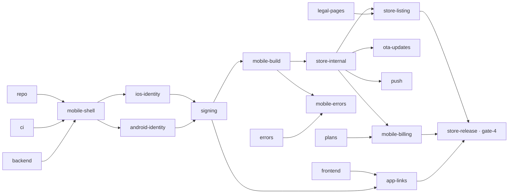

# PLAN (design source) — `launch` mobile: iOS + Android as one more slot group

> **v1.0. Landed owner-instructed 2026-10-20** ("repo la podu"), disk only. The owner branches, commits and PRs it.
> **Trigger FIRED by owner ruling 2026-10-20**: *"ne mobile ku plan ready pannu"*. The first real venture,
> `myfitfolio`, needs iOS and Android apps, and launch today builds web only (0 mobile slots in an 86-slot catalog).
> **This plan feeds `/arc-kickoff --lane launch` as the design source of launch Cycle 3**, opened after Cycle 2
> closes. Decisions are named **MOB-A…MOB-G**. Real ADR numbers are assigned at kickoff from the next free number in
> the lane's 1700 century, never written here.
> This plan does **not** supersede `PLAN-launch.md`. That file stays the design source of the slot process this plan
> extends.
>
> **Owner facts this plan is built on (2026-10-20):**
> - DotInfo Solution is a **sole proprietorship**.
> - The first mobile venture is `myfitfolio`.
> - The stack is Expo / React Native, because the web shell is TypeScript (chat ruling).

---

## 0. Where this fits: the running cycle, checked live

The board was read from `initiatives/*/PROGRESS.md` on 2026-10-20:

| lane | status | position | appetite / burn | note |
|---|---|---|---|---|
| **launch** | **LIVE** | Cycle 2 "the first real venture", **Phase 06** | 15d / 0d (2026-10-19 → 11-02) | done line = REQ-20: `verify --all --venture myfitfolio` green, **34 core slots** |
| growth | LIVE | Phase 06 | 10d / 8d | blocked on owner (Search Console CSV) |
| leads | LIVE | Phase 03 | 11d / 7.5d | — |
| others | IDLE | — | — | — |

### Verdict: do not put mobile inside launch Cycle 2. Make it the whole of launch Cycle 3.

There are four reasons, each checked against the tree:

1. **The 100% rule.** Cycle 2's phases sum to 12.5d of a 15d appetite. Mobile needs ~8d (§6). Putting it inside
   means 15d → ~21d, which is exactly the "never extend silently" breach the Appetite section forbids. It also pushes
   the day-7.5 tripwire past Phase 07.
2. **REQ-20's count.** Cycle 2's done line is pinned to a derived core count of 34. Mobile slots are tiered
   `required` (MOB-B below), so they would not move that number. But a mid-cycle catalog edit still lands
   `products/launch/**` changes, and with them a sync-golden regeneration, inside the same phases that edit
   `lib/ctx.mjs` and the runner. Cycle 2's own pre-mortem #3 is the twin-fix risk this would raise.
3. **The profile changes shape.** MOB-A adds a required profile field. `loadProfile` rejects any profile that lacks it
   (`catalog.mjs` iterates every `PROFILE_FIELDS` key). That means `myfitfolio.venture.yaml` changes in the middle of
   its own first real run, and that file is untracked in the main clone.
4. **The app does not exist yet.** The trainer and client screens are product work. Until a real build exists, the
   store-production slot can only be fixture-proven, so nothing in Cycle 2's done line could use it anyway.

**What does happen now:**
- **Track A, the owner's calendar-gated store accounts (§2), starts today.** This is where the real waiting is.
- **Cycle 3 = this plan only.** Cycle 2's PLAN names C2-01…C2-05 for Cycle 3 (ADR-1768). This plan moves them,
  unchanged, to **Cycle 4**. Those 35 `required` slots are larger than this whole plan, and mobile is what the first
  real venture is waiting on. MOB-B records the amendment to ADR-1768's ordering clause at kickoff.
- Before Cycle 3's kickoff, the owner may run one docs-only `/arc-change --lane launch` so that Cycle 2's "Next cycle"
  section points here. If it is not run, the kickoff's MOB-B ADR carries the amendment alone (gate G3).
- When Cycle 2 closes (on or before 2026-11-02), `/arc-kickoff --lane launch` opens Cycle 3 with the prompt at the
  bottom of this file.

**If the owner still wants it inside Cycle 2**, Appendix A gives the `/arc-change` shape: three phases appended,
appetite 15d → 23d recorded openly, and a new tripwire. It is the weaker path.

---

## 1. Goal

`myfitfolio` (and every later venture whose profile says so) gets an iOS and Android app pipeline from the same one
command. It takes a venture from code to signed builds, internal testers, store listing and, behind an owner gate,
the public stores. As with every other slot, each step is proven by something outside the repo answering.

**Fixed (Layer 1):** the `mobile` slot group and each slot's exit criteria.
**Free (Layer 2):** which tool fills each slot. Expo / EAS are *initial candidates*, never defaults (ADR-1703).

---

## 2. Track A: owner acts, calendar-gated (start today)

DotInfo Solution is a sole proprietorship, so the account path is decided:

| # | Act | Why this way | Wait |
|---|---|---|---|
| A1 | **Apple Developer Program: enroll as an *individual*, with your own legal name and your own card** | Apple's enrollment page: *"If you are a sole proprietor/single-person business, you must join as an individual and your legal name will appear as the seller."* No D-U-N-S is needed. The app name stays **MyFitFolio**; only the *seller* line shows your name. If DotInfo is incorporated later, Apple Support converts the account. | ~1–2 days |
| A2 | **Google Play Console: *personal* account** | An org account needs a D-U-N-S, and a proprietorship gains nothing from one here. The cost is the **12 testers × 14 days closed test** before production. That clock is not wasted, because the real app is not ready for production either. | identity check, a few days |
| A3 | **Start the 12-tester list now**: trainers and clients from your own network | This satisfies Google's rule, and it is MyFitFolio's first user research at the same time. They opt in once the first internal build exists (Phase 12). | — |
| A4 | **Expo account** (free) + a personal access token in `~/.arc-private/launch/` | EAS Build / Submit / Update. The Free plan gives a limited number of low-priority builds per month; Starter is $19/mo if queue time hurts (assumption A-M2). | minutes |
| A5 | **App Store Connect API key** (Admin, `.p8`) + **Play service account JSON** | Read and submit access for the adapters. Like every key, it is placed by the owner and never fetched by launch (ADR-1713, ADR-1724). | after A1 / A2 |
| A6 | **Android upload keystore**: one offline backup that only you hold | If it is lost, Play App Signing can reset the upload key, but only through a support request. Keep it off git. | — |

---

## 3. Current state: what exists and what does not

- **Catalog:** 86 slots in 11 groups (`identity · delivery · stack · users · money · trust · observability · data ·
  growth · ai · wiring`). A grep for mobile, ios, android, expo or store finds **0** hits in `launch.slots.yaml` and
  `launch.providers.yaml`.
- **Profile grammar:** `PROFILE_FIELDS` in `.claude/scripts/launch/lib/catalog.mjs` has `type · region ·
  payment_model · tenancy · ai · honesty_class`, and **no platform field**. `loadProfile` requires every field, so
  adding one is a breaking change for the three profiles (`arc-sandbox`, `invoice-reminders-6e390c`, `myfitfolio`).
- **Predicate grammar:** `always | FIELD ==|!= VALUE`, joined by ` and `, scalars only (`parsePredicate`). A
  **scalar** mobile field fits it with **zero grammar change**.
- **Gates:** `GATES = none · gate-1 · gate-2 · gate-3`. A public store release has no gate.
- **Adapters:** four exports (`envContract · scaffold · verify · teardown`). They may import `node:` built-ins only
  (ADR-1715), so the App Store Connect ES256 JWT and the Play RS256 service-account JWT are signed with
  `node:crypto` (A-M5).
- **Twin sites for any profile field:** `catalog.mjs` `PROFILE_FIELDS`; the predicate error text in
  `parsePredicate`; **`.claude/scripts/discover/lib/export.mjs` lines 17, 44 and 70**, which hold three hard-coded
  field lists, so discover's exporter throws `SHAPE` the moment `PROFILE_FIELDS` gains a key it doesn't write;
  `docs/wiki/**`; and the sync golden.
- **Reusable as-is for an app:** `backend`, `database`, `auth`, `authz`, `tenancy`, `secrets`, `errors` (web),
  `legal-pages` (served `/privacy` is the store privacy URL), and `backup`. The app talks to the same backend.

---

## 4. Key decisions (MOB-A…MOB-G, all locked at landing; each becomes one ADR at kickoff)

| Letter | Decision | Reversibility |
|---|---|---|
| **MOB-A** | The venture profile gains `mobile: none \| ios \| android \| both`. It is **required and explicit in every profile**. A missing value is `SHAPE`, never assumed `none` (the no-default spirit of ADR-1703). Platform predicates are `mobile != none`, `mobile != android` (iOS applies), and `mobile != ios` (Android applies). The predicate grammar is unchanged. | two-way |
| **MOB-B** | A new slot group, **`mobile`**, holds 13 slots, all tier **`required`** with a `mobile` predicate, none of them `core`. The core count and Cycle 2's REQ-20 are untouched, and no core slot can depend on them (ADR-1717). **Cycle 3 is the mobile slice alone, and C2-01…C2-05 move unchanged to Cycle 4.** This amends ADR-1768's ordering clause only. | two-way |
| **MOB-C** | **`gate-4` = the first public store release** (App Store "ready for sale", Play production track). It needs owner approval, and a walk never answers it (ADR-1767). Internal and closed tracks are `gate: none`, because they are private and reversible. | one-way per release |
| **MOB-D** | **Store accounts are owner-attested, read-only probes**, on the pattern of ADR-1766. Launch never creates an Apple or Google account. It reads that the ASC key lists the bundle id and that the service account can open the Play app. Play's API needs an *edit* even to read; `insert` + `delete` with **no `commit`** counts as read-only (A-M3). | two-way |
| **MOB-E** | **`mobile-billing` is a recorded route per platform, never inferred**: `web-only` (multiplatform service, no purchase UI), `iap`, or `play-ucb` (Play user choice billing in India). The `web-only` route is verified by **scanning the built JS bundle for purchase entry points** (price strings, checkout or upgrade URLs, payment-host links). Building IAP is out of scope (Cycle 4, its own ADR). | two-way |
| **MOB-F** | **A device-only fact is verified only by the owner's device.** `push` is verified by a push receipt to a token the owner's own phone registered from the internal build. It is never simulated, and a missing device receipt is `failed(device:none)`. | two-way |
| **MOB-G** | **Initial candidates: Expo SDK + EAS Build / Submit / Update.** Recorded alternatives, not banned: Flutter (no shared TypeScript with the web shell) and Capacitor (wraps the web shell; native feel and push are weaker). A second provider later enters by row + adapter only (REQ-08's rule). | two-way |

---

## 5. The `mobile` slot group: 13 slots (seed; `launch.slots.yaml` is the truth)

Tier **R** = `required`. Predicates use MOB-A. Every exit proof is something outside the repo answering.

| Slot | Predicate | Initial candidate | Exit proof (verify) | depends_on |
|---|---|---|---|---|
| `mobile-shell` | `mobile != none` | Expo app in the venture repo (`apps/mobile/`), committed through the GitHub API (ADR-1726) | the venture's CI run on `main` is green **with the mobile job present** (GitHub API answers); `expo-doctor` clean in that job | repo, ci, backend |
| `ios-identity` | `mobile != android` | App Store Connect API | `GET /v1/bundleIds` lists the venture's bundle id under the owner's team; the app record exists (MOB-D) | mobile-shell |
| `android-identity` | `mobile != ios` | Google Play Developer API | edit `insert` → read app details → edit `delete`, never committed; the package name matches the profile (MOB-D) | mobile-shell |
| `signing` | `mobile != none` | EAS remote credentials | EAS lists an iOS distribution cert + profile and an Android upload key for this app; Play App Signing enrolled; **no secret byte ever fetched** | ios-identity, android-identity* |
| `mobile-build` | `mobile != none` | EAS Build | for each applicable platform, EAS answers build `FINISHED` **with `gitCommitHash` equal to `main`'s sha** | signing |
| `store-internal` | `mobile != none` | EAS Submit | ASC: build `processingState: VALID` on TestFlight internal; Play: the `internal` track holds that versionCode | mobile-build |
| `app-links` | `mobile != none` | served from the web shell | `https://@venture/.well-known/apple-app-site-association` (team id + bundle id) and `/.well-known/assetlinks.json` (package + SHA-256 of the **Play signing** cert) both served 200, correct content type, and matching | frontend, signing |
| `mobile-errors` | `mobile != none` | Sentry (React Native) | Sentry API: the release for this build version has source maps (JS) and dSYMs / mapping uploaded | mobile-build, errors |
| `ota-updates` | `mobile != none` | EAS Update | an update published to the `preview` channel for the latest build's `runtimeVersion` is listed; a **rollback** republish of the previous group is listed after it | store-internal |
| `push` | `mobile != none` | Expo Push (APNs key + FCM v1 on EAS) | push receipt `ok` for a token **the owner's phone registered** from the internal build (MOB-F) | store-internal |
| `mobile-billing` | `mobile != none and payment_model != none` | route `web-only` per platform (MOB-E) | a `decision.recorded` route per platform; for `web-only`, the bundle scan of the `store-internal` artifact finds 0 purchase entry points | store-internal, plans |
| `store-listing` | `mobile != none` | ASC API + owner-attested Play form | ASC `privacyPolicyUrl` equals the served `legal-pages` `/privacy` (200); an account-deletion URL is served (both stores require one); **Play Data safety has no API, so it is owner-attested and the receipt says so** (A-M7) | store-internal, legal-pages |
| `store-release` | `mobile != none` | EAS Submit, production | **gate-4** (MOB-C): ASC version `READY_FOR_SALE`; Play `production` track status `completed` | store-listing, mobile-billing, app-links |

\* `signing` depends on both platform identities. On a one-platform profile, the other identity is written
`skipped`, and the runner already counts `skipped` as a met dependency (`lib/runner.mjs:158`: verified, skipped or
absent). **No engine change is needed.** Phase 11 adds a fixture that pins this for `mobile: ios` and
`mobile: android`.

---

## 6. Phases (Cycle 3 numbering continues from Cycle 2's last, 11+; risk-ordered)

| Phase | Capability | Appetite | Owner acts |
|---|---|---|---|
| **11** | **Contracts.** ADRs MOB-A..MOB-G; the `mobile` group + 13 rows; `mobile` in `PROFILE_FIELDS` + predicate error text; **discover `export.mjs` twin (lines 17/44/70)**; the 3 profiles migrated in the same PR (`myfitfolio` is the owner's hand edit, because it is untracked in the main clone); `gate-4` in `GATES`; a fixture pinning skipped-identity → `signing` for one-platform profiles; 13 candidate provider rows; `launch-lint --self-test` gains mutants (missing `mobile`, `mobile: yes`, a core→mobile edge, `gate-5`); wiki + sync golden regenerated | 1d | migrate `myfitfolio.venture.yaml` |
| **12** | **Steel thread on `arc-sandbox` (rehearsal).** shell → identities → signing → build → **store-internal**. **Kill line, day 3 of the cycle: an internal build from `main` installs on the owner's phone from TestFlight and from Play internal.** Not reached → scope-cut talk | 3d | A1–A5 done; install the build |
| **13** | **The rest of the internal surface.** `app-links`, `mobile-errors`, `ota-updates`, `push` (owner-device receipt), `mobile-billing` (route + bundle scan) | 2d | record the billing route; open the app once for the push token |
| **14** | **`myfitfolio` to internal + listing ready.** Profile `mobile: both`; walk to `store-internal` + `store-listing` live with `honesty_class: real`; closed test opened for the 12 testers (A3). **`store-release` is fixture-proven only. Its live verify is OPEN-at-first-release**, the way Cycle 1's REQ-12 was, because an empty shell would fail store review on minimum functionality | 1.5d | vetting stamps; Play Data safety form |
| **15** | **Close.** Coverage, evidence, retro, HISTORY | 0.5d | close stamp |

**Sum 8d · appetite 9d** (one day of slack). Tripwire: day 4.5, Phase 12 not closed → the scope-cut conversation.
**Cut order, fixed now:** (1) `push`; (2) `ota-updates`; (3) `mobile-errors`. `mobile-shell → store-internal`,
`app-links`, `mobile-billing` and `store-release`'s fixtures are never cut.

> Correction to the chat estimate (2026-10-20, "5–6 days"): that counted ~8 slots. The tree needs 13, because
> platform identity splits in two, and `app-links`, `mobile-errors` and `store-listing` are real store requirements.
> The honest number is **8d of arc work**. The store calendar runs alongside it.

---

## 7. Success requirements (REQ numbers continue from Cycle 2's REQ-21; assigned at kickoff)

| REQ | User outcome | Measurable acceptance | Phase |
|---|---|---|---|
| M-01 | A web-only venture is untouched by mobile | `arc-sandbox` with `mobile: none` shows all 13 mobile slots `skipped (predicate false: mobile != none)`; `plan` output for every core slot is byte-identical to Cycle 2's golden; the core count is unchanged (`launch-coverage`) | 11 |
| M-02 | A profile can never be silently mobile or silently not | a profile missing `mobile` → `SHAPE`; `mobile: yes` → `SHAPE`; discover's exporter writes `mobile` and its suite asserts the field RAN; 4 lint mutants each refused | 11 |
| M-03 | The owner gets a signed internal build from one walk | from the main clone, the mobile walk on `arc-sandbox` reaches `store-internal` verified on both platforms; build `gitCommitHash` = `main` sha in evidence; a second apply creates 0 resources | 12 |
| M-04 | Nothing secret leaves the owner's box | a sentinel planted in the ASC key, Play JSON and Expo token appears in no receipt, state file, stdout or stderr (fixture); adapters import no package (`zero-dep-leg`) | 12 |
| M-05 | Links, crashes, updates and pushes are proven, not claimed | `app-links` both files served and matching; `mobile-errors` symbol upload listed by Sentry; `ota-updates` publish + rollback listed; `push` receipt `ok` from the owner's device, and with no device → `failed(device:none)` (fixture) | 13 |
| M-06 | The app can't be rejected for a purchase link it didn't mean to ship | `mobile-billing` route recorded per platform; bundle-scan fixture: a planted `₹499/mo` string or a checkout URL turns the slot `failed(billing:entry-point)`; a clean bundle passes | 13 |
| M-07 | `myfitfolio` reaches testers on real receipts | `myfitfolio` `store-internal` + `store-listing` verified, `honesty_class: real`; the closed test is open; the 12-tester opt-in count is recorded in evidence | 14 |
| M-08 | The public release can only happen through the owner | `store-release` fixtures: no approval → exit 5 `awaiting-approval`; `--all` never answers gate-4 (emit count asserted); live verify is recorded as **OPEN-at-first-release** with its trigger | 14 |

---

## 8. Non-negotiables (inherited, plus four new)

Every Cycle 1/2 non-negotiable stands (no default provider, owner-only rows, four-function adapters, `ctx.fetch`
allow-list, zero new spine kinds, secrets never in git, verify = an outside answer, tests on CI only). New:
- **Launch never creates a store account, never accepts an Apple or Google agreement, and never answers gate-4.**
- **No secret byte is fetched from EAS or the stores.** Credentials are listed by id, never downloaded.
- **Store review notes and owner contact details stay out of git** (the arc repo is public).
- **No app screens.** Launch ships a shell that boots, logs in through the venture's `auth`, and calls `/health`.
  MyFitFolio's trainer and client features are product work in the venture repo.

## 9. No-gos

- No IAP / StoreKit / Play Billing integration (MOB-E routes it to Cycle 4).
- No device farm, Maestro or Detox E2E. The one device fact (`push`) is the owner's phone.
- No Mac and no local Xcode path. EAS builds in the cloud.
- No `required`-tier C2-01 slots inside this slice.
- No D-U-N-S, no Apple org account, and no company incorporation work.
- No Play Data safety scraping. It is owner-attested and labelled as such.

## 10. Rabbit holes

1. **Making the shell "a real app".** One screen, one login, one `/health` call. Anything more is MyFitFolio.
2. **Chasing iOS review rules in code.** A rejection is an assumption trigger with an owner decision (A-M4), not a
   refactor.
3. **Hosting the bundle scan's word list in the adapter.** It lives in `lib/`, so a list update moves no digest
   (Cycle 2 pre-mortem #4).
4. **Treating Play's edit `insert` + `delete` as harmless and skipping the no-commit assertion.** The fixture asserts
   `commit` was never called.

## 11. Assumptions ledger

| # | Assumption | Trigger (how we'd know it's wrong) | Phase |
|---|---|---|---|
| A-M1 | TestFlight internal and Play internal need no store review for a shell | upload accepted but blocked "in review" → internal proof moves to the closed track, recorded by ADR | 12 |
| A-M2 | EAS Free's low-priority queue fits the cycle | a build waits > 2h twice → owner decides on Starter ($19/mo) | 12 |
| A-M3 | Play edit `insert` → read → `delete` is accepted as read-only by the owner's policy | owner or policy-lint objects → `android-identity` becomes owner-attested like Play Data safety | 11 |
| A-M4 | Apple accepts a **web-only** route for the trainer subscription under 3.1.3(b) Multiplatform Services | a 3.1.1 rejection at first release (this has happened to SaaS apps with *no* purchase UI, per an Apple forums thread) → owner picks IAP or `play-ucb`/IAP split; Cycle 4 ADR. Note: client↔trainer **live 1:1 sessions** may fall under 3.1.3(d) person-to-person services, which allows non-IAP payment. To be checked against the current guidelines at that time | 14 → first release |
| A-M5 | `node:crypto` signs the ES256 (ASC) and RS256 (Google) JWTs with no package | a key format `node:crypto` can't import → `lib/` helper by ADR, still zero-dep | 12 |
| A-M6 | EAS's GraphQL API exposes build status + `gitCommitHash` to a token | field missing → verify reads the build's git ref from EAS metadata, and the change is recorded | 12 |
| A-M7 | Play Data safety stays console-only | an API appears → `store-listing` drops the owner attestation | 14 |

## 12. Pre-mortem (6 months on, mobile shipped and failed)

| # | Cause | Mitigation |
|---|---|---|
| 1 | **Twin-fix:** `mobile` added to `PROFILE_FIELDS` but discover's exporter kept its three hard-coded lists, and every hunt export died at `SHAPE` | Phase 11 greps every reader of `PROFILE_FIELDS` and every literal field list; discover's suite asserts `mobile` is written; `fixed-defects.md` gains the pattern |
| 2 | The Android upload keystore or the ASC key was lost or leaked | A6 offline backup is an owner act named up front; the M-04 sentinel fixture; credentials are listed, never fetched |
| 3 | The 14-day Play clock started late because testers were gathered only after the build | A3 starts today; Phase 14 records the opt-in count |
| 4 | The first real release was rejected for billing and launch had no route for it | MOB-E makes the route an explicit owner decision with a bundle scan; A-M4 names the fallback before the release |
| 5 | Mobile slipped into Cycle 2 and the first real venture's done line slid | §0 verdict: mobile is Cycle 3 alone; Appendix A only by an explicit owner ruling |

## 13. External dependencies

| Dep | Interface (adapter over `ctx.fetch`) | Fake | Real |
|---|---|---|---|
| GitHub | `providers/mobile-shell/expo-shell.mjs` (`api.github.com`) | existing fake repo + CI run with a mobile job | venture repo |
| Expo / EAS | `mobile-build`, `signing`, `store-internal`, `ota-updates`, `push` (`api.expo.dev`, `exp.host`) | fake GraphQL: build FINISHED / ERRORED, credentials list, update groups, push receipts | owner's Expo token |
| App Store Connect | `ios-identity`, `store-listing`, `store-release` (`api.appstoreconnect.apple.com`) | fake bundleIds, builds, versions | ASC API key (ES256 JWT) |
| Google Play | `android-identity`, `store-internal`, `store-release` (`androidpublisher.googleapis.com`, `oauth2.googleapis.com`) | fake edits (asserting no `commit` on reads), tracks | service account (RS256 JWT) |
| Sentry | `mobile-errors` (`sentry.io`) | fake release + artifact list | owner-held Sentry token |
| Venture site | `app-links` (`@venture`) | fake site with / without `.well-known` files | `brand.domain` |

---

## Appendix A — only if the owner rules "inside Cycle 2"

`/arc-change --lane launch` appends **Phases 11–13**: §6 Phases 11, 12 and 13+14 merged, with 15 dropped because
Cycle 2's Phase 10 closes both. **Appetite 15d → 23d, recorded in PLAN § Appetite as an owner ruling**, never
absorbed. New tripwire: day 11.5, Phase 07 not done → scope-cut, with mobile first in the cut order. REQ-20 is
untouched (mobile is `required` tier). Cost: Cycle 2's done line moves from 2026-11-02 to about 2026-11-10, and
Phase 11's profile change lands while `myfitfolio`'s core walk is live.

## Appendix B — sources checked 2026-10-20

- Apple Developer, enrollment help (sole proprietor → individual; legal name as seller): https://developer.apple.com/support/enrollment/
- Google Play, testing requirements for new personal accounts (12 testers × 14 days): https://support.google.com/googleplay/android-developer/answer/14151465
- Google Play, user choice billing incl. India (fee reduced by 4% on alternative billing): https://support.google.com/googleplay/android-developer/answer/13821247
- Expo, plans (Free = limited low-priority builds; Starter $19/mo): https://docs.expo.dev/billing/plans/
- Apple Developer Forums, 3.1.1 rejection of a web-checkout SaaS app with no purchase UI: https://developer.apple.com/forums/thread/828238

## Gates at kickoff (checked before the prompt is pasted)

| # | Gate | How to check |
|---|---|---|
| G1 | **Launch Cycle 2 is sealed.** Phase 10 is closed and the lane is IDLE | `initiatives/launch/PROGRESS.md` header `status: IDLE` |
| G2 | **Track A is far enough along.** Apple individual enrollment approved (A1), Play personal account verified (A2), Expo token placed (A4) | owner says so; Phase 12 cannot start without A1, A2 and A5, so a kickoff without them only moves the stall into Phase 12 |
| G3 | **ADR-1768's ordering is amended in exactly one place.** Either Cycle 2's "Next cycle" section was updated by a docs-only `/arc-change`, or the kickoff writes MOB-B as the amending ADR. Never both silently, and never neither | read Cycle 2's PLAN "Next cycle" section and the kickoff's ADR list |
| G4 | **Discover's exporter is still the only other writer of a venture profile** | `grep -rn "PROFILE_FIELDS" .claude/scripts` lists only `launch/lib/catalog.mjs`, `launch/launch-lint.mjs` and `discover/lib/export.mjs`; a new reader joins Phase 11's twin list |
| G5 | **The store facts in Appendix B are re-checked** (12 testers × 14 days, sole-proprietor enrollment, Play user choice billing in India, EAS Free limits) | open the five links; any changed fact goes into PLAN.md as a corrected assumption row |

## Relationship to other plans

- **`PLAN-launch.md`** stays the design source of the slot process. This plan adds one group to it and changes none
  of its LAU-* decisions. MOB-A extends LAU-J's profile, MOB-C extends LAU-H's gates, and MOB-D follows ADR-1766.
- **`PLAN-discover.md`**: its exporter writes `venture.yaml` against `PROFILE_FIELDS` (DIS-E). MOB-A changes that
  contract, so Phase 11 updates `export.mjs` in the same PR (pre-mortem #1).
- **`PLAN-legal-pack.md`**: `store-listing` reads the served `/privacy` that the legal lane publishes. No legal text
  is written here.
- **`PLAN-cycle3-venture-launch.md`** is unrelated to launch Cycle 3, despite the name. It stays the `launch-kit`
  slot's checklist (strategy README correction #29).
- **Cycle 4 of launch** carries C2-01…C2-05 unchanged (MOB-B).

## KICKOFF PROMPT — paste into Claude Code in the arc repo (after gates G1–G5 clear)

> Read `docs/strategy/plans/PLAN-launch-mobile.md` end to end before doing anything. Read
> `initiatives/launch/PLAN.md` (Cycle 2, sealed) for the non-negotiables this cycle inherits. Then run
> `/arc-kickoff "launch Cycle 3: iOS and Android as one more slot group — Expo shell to signed builds, internal
> testers, store listing and a gated public release, every step proven by an outside answer" --lane launch`.
>
> Write PLAN.md and PROGRESS.md, archive Cycle 2's pair under `initiatives/launch/archive/` the way Cycle 1's was,
> number the phases from 11, then **stop and wait for my approval before any code.**
>
> These are locked and must appear in the PLAN you write:
>
> 1. **MOB-A**: `venture.yaml` gains `mobile: none | ios | android | both`, required and explicit. A missing value or
>    an unknown value is `SHAPE`, never assumed. Platform predicates are `mobile != none`, `mobile != android` and
>    `mobile != ios`. The predicate grammar does not change. **Twin sites, all in one PR:** `PROFILE_FIELDS` and the
>    predicate error text in `catalog.mjs`, `launch-lint`, **discover's `export.mjs` (three hard-coded field lists)**,
>    the three existing profiles (`myfitfolio` is my hand edit, because it is untracked in the main clone), the
>    wiki, and the sync golden.
> 2. **MOB-B**: a new group, `mobile`, of 13 slots, all tier `required`, none `core`. The core count stays what
>    `launch-coverage` derives. **This cycle is the mobile slice only. C2-01…C2-05 move unchanged to Cycle 4**,
>    recorded as the ADR amending ADR-1768's ordering clause (unless gate G3 shows the `/arc-change` already did it).
> 3. **MOB-C**: `gate-4` = the first public store release (App Store ready-for-sale, Play production). It needs my
>    approval, and `apply --all` never answers it (emit count asserted). Internal and closed tracks are `gate: none`.
> 4. **MOB-D**: store accounts are owner-attested, read-only probes on ADR-1766's pattern. Launch never creates an
>    Apple or Google account and never accepts an agreement. Play reads use edit `insert` → read → `delete`, and a
>    fixture asserts `commit` was never called.
> 5. **MOB-E**: `mobile-billing` is a `decision.recorded` route per platform (`web-only | iap | play-ucb`). `web-only`
>    is verified by a bundle scan for purchase entry points, and the word list lives in `lib/`, not in an adapter.
>    No IAP code this cycle.
> 6. **MOB-F**: `push` is verified only by a receipt to a token my own phone registered. No device →
>    `failed(device:none)`, never simulated.
> 7. **MOB-G**: Expo SDK + EAS Build / Submit / Update are initial candidates, never defaults. Every row starts
>    `candidate` and is vetted by the usual scout + live verify + `decision.recorded` + digest.
> 8. Every Cycle 1/2 non-negotiable stands. Adapters import `node:` built-ins only (ADR-1715), so the ASC ES256 and
>    Google RS256 JWTs are signed with `node:crypto`. No secret byte is fetched from EAS or the stores; credentials
>    are listed by id. Tests run on CI only.
> 9. Phase order is contracts (11) → steel thread on `arc-sandbox` to `store-internal` (12) → app-links, errors,
>    OTA, push and billing (13) → `myfitfolio` to internal + listing (14) → close (15). Do not reorder. **The day-3
>    kill question:** *does an internal build from `main` install on the owner's phone from TestFlight and from Play
>    internal?*
> 10. `store-release`'s live verify is recorded **OPEN-at-first-release** in PLAN.md's acceptance table from day
>     one. A launch shell is not a store-reviewable app.
> 11. No app screens. The shell boots, logs in through the venture's `auth`, and calls `/health`. MyFitFolio's
>     features are product work in its own repo.
> 12. Take ADR numbers from the next free in the 1700 century after reading `PORTFOLIO.md` and sweeping sibling
>     worktrees and remote branches. No number written in the design source is binding.
>
> Appetite: 8 days effort, 9 cap. The tripwire is day 4.5: if Phase 12 is not closed, hold the scope-cut
> conversation. The cut order is `push` → `ota-updates` → `mobile-errors`.
