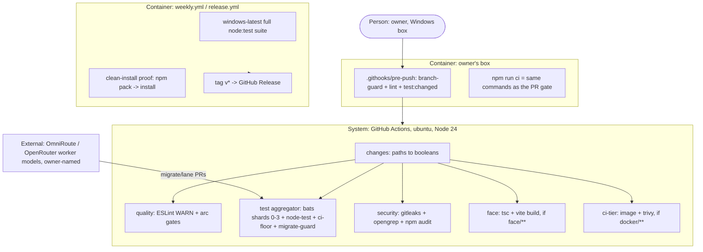

# PLAN.md — ci v1 "one Linux gate"

> Lane `ci`, Cycle 1. Design source: `docs/strategy/plans/PLAN-ci.md` v1.0 (owner ruling 2026-10-23,
> merged in #458). Its decisions CI-A…L and CI-O…S are LOCKED and are not re-litigated here. CI-M and
> CI-N were answered by the owner at kickoff on 2026-10-24. ADR century **2200–2299**.

## Goal

The owner's Windows box becomes arc's first test gate, and GitHub runs one ubuntu Node-24 PR gate
(`quality` · `test` · `security`, plus `face` / `ci-tier` when touched) with Windows + docker weekly
and tag-driven releases. This takes a PR push from ~1,070 billed minutes and 35 min wall clock to
~40–45 billed minutes, so arc can go private on GitHub Pro. The 4,815 bats tests then move to
`node:test` lane by lane behind a mechanical parity gate, run by parallel workers on models the
owner names.

## Current state

- **CI today** (`.github/workflows/ci.yml`, 324 lines, workflow `arc-ci`): 19 jobs per push, made of
  `selftest` on ubuntu Node 18/20/22, 3 macOS shards and 12 Windows shards, plus `ci-tier`. The
  test-count floor is hand-typed `911` (`ci.yml:280`), and the suite holds **4,815** `@test`s in 243
  files. The baseline was measured on run 39736016311: 35 min wall clock, ~1,070 billed minutes.
- **Three throwaway workflows:** `shard-calibrate.yml`, `weigh-tests.yml`, `measure-windows-cost.yml`.
  Their support files are `.github/scripts/shard-tests.mjs`, `tests/shard-timings.json` and
  `tests/shard-tests.bats`.
- **Commit-time hooks already exist** (ADR-2013): `.githooks/pre-commit`, and `.githooks/pre-push`
  (6 lines, which run `branch-guard.sh --pre-push`). CI-O therefore **extends `pre-push`**. It does
  not create a hook mechanism.
- **face-coverage reads workflows by FILE NAME** (`face-coverage.mjs:352` `treeCi`:
  `workflow:{basename}`). Rewriting `ci.yml` in place keeps `workflow:ci`. Only adding or deleting
  workflow files moves `initiatives/face/contracts/expected-set.json`, which is face's file.
- **`engine/enforcement.yaml` pins merge-time truth to bats tests.** Its `blocking` rows name
  `tests/{file}.bats::{test}` across 5 distinct files (distribute + engine), and `gate-parity.mjs:157`
  accepts ONLY that `.bats` shape or `repo:{setting}`. A lane whose pinned bats file is deleted turns
  `gate-parity` red. The source plan does not mention this.
- **`settings.json:61-62`** still denies `Edit`/`Write` on `.github/workflows/**` (CI-Q: the owner lifts
  it for this cycle).
- Node v24.18.0 on the owner's box. `package.json`: `dependencies: {}`, `engines.node >=18`, and
  `"test"` runs `ci-digest --wait`.
- **Do-not-touch:** `products/launch/providers/ci/github-actions.mjs` (launch's), `initiatives/face/contracts/expected-set.json` (face's), branch protection and repo visibility (owner's), `.claude/settings.json` (deny floor, owner's), source code under migration in Phase 02–04 (tests only).

## Success requirements

The source's REQ-09 (venture template) is owned by the LIVE `launch` lane (CI-P, ADR-0057), so it is
filed there as `/arc-change --lane launch` (Phase 01) and is not a ci REQ. The source's REQ-10/11 are
renumbered 09/10 to fit the Tier-M cap.

| REQ | User outcome | Measurable acceptance | Phase | Status |
|---|---|---|---|---|
| REQ-01 | A PR push starts only cheap ubuntu jobs | the run's job list shows only `ubuntu-latest` jobs on Node 24: ≤ 10 started jobs while bats remains, ≤ 7 after Phase 04 (skipped jobs not counted) ; per-job durations from `gh api repos/technology-ashiq/arc/actions/runs/{id}/jobs` for that run and again after the private flip recorded in `cost.md` beside baseline 39736016311 (35 min / ~1,070 billed) | 00 | active |
| REQ-03 | The owner sees the real cost per push, before and after | merged into REQ-01 by `/arc-change` 2026-10-24 (same run, same phase) to free a slot for REQ-11 | 00 | dropped |
| REQ-02 | Drafts and paperwork PRs cost nothing to sit open | one draft PR starts 0 billable jobs; one phase-close PR touching only `initiatives/*/PROGRESS.md`, `initiatives/*/evidence/**`, `PORTFOLIO.md` and `docs/**/*.md` runs `changes` + `quality` + `security` only, with `bats`/`node-test` `skipped`, and shows mergeable | 01 | active |
| REQ-11 | Editing a file costs no hidden work | the PostToolUse chain fires 0 `npx` processes and 0 `tool.postuse` spine events per Edit (spine count before/after one 10-edit session), the read hook spawns 0 child processes when `.claude/state/design/composer-session` is absent, SessionEnd leaves `git status --short` empty, and a fresh `sync-to-project.sh` target holds none of the 3 retired fragments | 01 | active |
| REQ-04 | Local green means CI green | `npm run ci` runs the same command list as the `quality` + `test` jobs; a diff of script vs workflow steps shows 0 missing commands | 01 | active |
| REQ-05 | A broken changed-lane test never leaves the box | negative control: a planted failing test in one changed lane makes `git push` exit non-zero from `.githooks/pre-push`, also from a worktree whose local `origin/main` is 20 commits behind | 01 | active |
| REQ-07 | Windows and docker are still proven, just not per push | after merge, one `weekly.yml` dispatch on `main` whose `windows-latest` log prints `# tests N` with N ≥ 1, with suite + clean-install proof + `ci-tier` all `success` | 01 | active |
| REQ-09 | Worker migrations cannot weaken tests unseen | `migrate-guard` returns FAIL on one planted mutant per D.4 guard (6 guards, 6 mutants) in `tests/core/` | 02 | active |
| REQ-10 | The owner picks the fan-out model on numbers | pilot scorecard (first-push PASS, review findings by severity, negative control caught, wall time, cost) recorded for both models in `tests/spine/MIGRATED.md` and `tests/jobs/MIGRATED.md` before any fan-out PR opens | 03 | active |
| REQ-06 | One test runner, no silent test loss | 0 `.bats` files remain; each lane merged under the §6 parity gate; `ci-floor.mjs` reports declared ≥ 4,815 minus the `DROPPED.md`/`MIGRATED.md` drop rows | 04 | active |
| REQ-08 | The cycle closes clean | `.github/workflows/**` deny restored in `settings.json`; ADR-2200..2212 merged; `wiki-build --check` + `face-coverage` green; sync golden regenerated, on the close commit's CI | 04 | active |

## Appetite

**~5 days** (owner, kickoff paste: "Tier M, ~5 days unless the owner says otherwise").

**Tier:** M

Phases: 00 = 0.5d · 01 = 1.25d · 02 = 1d · 03 = 0.5d · 04 = 1.5d · slack 0.25d.

**Kill criteria:** at 50% (day 2.5), if Phase 02 isn't done → mandatory scope-cut conversation. At
100% → cut or kill, never extend silently. Plus the source's §11 kill line, checked at Phase 02
exit: the `org` lane under `node:test` is not ≥ 5x faster than under bats on the owner's box, **or**
both pilot models fail `migrate-guard` on first push **and** both have a weakened assertion found in
review → stop the migration, keep the Phase 00–01 pipeline (it alone takes ~1,070 → ~40–45 billed
minutes), and re-plan.

## Architecture (C4 concepts, Mermaid flowchart)



## Key decisions (ADR index)

| # | Decision | Status |
|---|---|---|
| 2200 | The `ci` lane is born: arc's CI becomes local-first with one Linux gate | accepted |
| 2201 | CI-A/B/C/I/K/O: local-first, one ubuntu PR gate, macOS dropped, weekly Windows + docker, pipeline hygiene, pre-push extended | accepted |
| 2202 | CI-E/F/G/H: `node:test` replaces bats, tests mirror the source, lane-by-lane parity gate, per-lane `.count` | accepted |
| 2203 | CI-D: Node 24 only | accepted |
| 2204 | Required checks are the named jobs (`quality`, `test`, `security`, `face`, `ci-tier`), cut over in the §5 order | accepted |
| 2205 | CI-P: the venture CI template goes ubuntu-only, filed to the launch lane | accepted |
| 2206 | CI-M: GitHub Pro, private repo, protection kept (owner, 2026-10-24) | accepted |
| 2207 | CI-N + CI-S: ESLint as a devDependency, WARN in TRIAL; `migrate-guard` + per-lane floors FAIL from birth | accepted |
| 2208 | CI-J: the security job + Dependabot + one full-history gitleaks scan | accepted |
| 2209 | CI-L: CD is tag-driven, with no release-please | accepted |
| 2210 | CI-Q: `.github/` write access for this cycle only, restored at close | accepted |
| 2211 | CI-R: Phase D runs as parallel workers on owner-named models, trusted only through mechanical guards | accepted |
| 2212 | Paperwork PRs run quality only; dead dev-loop hooks retired; session-log dropped (`/arc-change` 2026-10-24) | accepted |

## Non-negotiables

- Branch-only writes: every change goes on a `feat/ci-*` or `migrate/{lane}` branch through a PR; never a commit to `main`.
- Never edit branch protection: at the cut-over, STOP and print the §5 step-2 list for the owner.
- Every action in every workflow is pinned by full commit SHA, with the tag in a trailing comment.
- Path filtering happens at job level through a `changes` job, never through workflow-level `paths` / `paths-ignore`.
- `migrate-guard` and the per-lane floors are FAIL from birth; ESLint starts WARN (CI-S).
- launch's ci provider and face's expected-set change only through `/arc-change` on their own lanes (CI-P, Phase 01).
- `npm run ci` locally before every push, then read CI per job with `ci-digest.mjs`, head SHA asserted.
- A migrated test asserts the SAME behaviour: no loosened assertion and no skipped, pending or `.only` test; a dropped test is listed with its reason in `MIGRATED.md`.
- Runtime `dependencies` stays `{}`; ESLint is the only devDependency, with a committed lockfile.
- Two-surface adversarial pass via `/arc-attack` (ADR-0226) per PR, carrying `initiatives/ci/fixed-defects.md`; the author is never the attacker.

## No-gos (explicitly out of scope)

- macOS in any workflow (CI-C).
- bats on Windows in `weekly.yml` (~4.3 h); weekly runs `node:test` lanes only until Phase 04.
- release-please, lefthook, Prettier/Biome, coverage reports, self-hosted runners, Node 26 (source Phase F).
- Editing `products/launch/providers/ci/github-actions.mjs` or `initiatives/face/contracts/expected-set.json` from this lane.
- Choosing a worker model: the owner names every model per run (ADR-0069 b1).
- Editing branch protection or repo visibility from a session.

## Rabbit holes

- **Pinned merge-time bats tests** (5 files in `engine/enforcement.yaml`). Phase 02 extends `gate-parity.mjs:157` to accept `tests/{lane}/{file}.test.mjs::{name}` too, and their lanes go to Opus, who repoints the row in the same PR. Workers never touch `engine/`.
- **Node 24 behaviour drift.** The suite has never run on 24. Phase 00's first run is the probe; a failure that is a real Node-24 break is fixed in the code, never skipped.
- **Old required checks lock the PR.** `selftest (…)` names vanish, so Phase 00's PR cannot merge until the owner does §5 step 2. Do not try to work around it.
- **ESLint first-run flood.** Fix real errors only. Any rule turned off carries a one-line reason in `eslint.config.mjs`; there is no blanket disable.
- **2 vCPU on private runners** after the flip slows `node --test`. REQ-03 re-measures it; shard count is a `test`-internal change, not a protection change.

## Assumptions ledger

| Assumption | How we'd know it's wrong (trigger) | Phase tests it |
|---|---|---|
| A-01: the bats suite passes on ubuntu Node 24 as it does on 22 | a red bats shard whose files, run alone on a Node-22 dispatch and a Node-24 dispatch, pass on 22 and fail on 24 FIRED 2026-10-24 (launch-contract rollback fixture: node --test spec reporter default since Node 23; pinned tap, evidence/phase-00/runs.md) | 00 |
| A-02: round-robin by file over 4 shards lands each shard within ~2x of the others | any shard > 2x the fastest in REQ-03's per-job durations | 00 |
| A-03: GitHub counts an `if:`-skipped required job as passing | REQ-02's docs-only PR shows "required check expected" instead of mergeable | 01 |
| A-04: `test:changed` on the owner's box finishes a typical one-lane push in < 5 min while bats remains | 3 consecutive pushes with pre-push > 5 min FIRED 2026-10-24 (strikes: stacked p01, a one-line distribute test fix, p02 at 306 s; whole bats lanes ran for one changed file). Routed by /arc-change: a bats lane runs only the files that name a changed path | 01 |
| A-05: `org` under `node:test` is ≥ 5x faster than under bats on the owner's box | Phase 02 timing below 5x → §11 kill line FIRED 2026-10-24 (org 678 s bats vs 222 s node:test = 3.05x; routed by /arc-change to a pilot: slow cases split into own files, 117-145 s = ~5.2x; owner ruled pass 2026-10-24, Phase D continues) | 02 |
| A-06: an owner-named non-Claude model can drive the worker harness through OmniRoute with working tool calls | SUPERSEDED 2026-10-24: the owner named Claude models on the subscription (ADR-2211 amendment), no gateway. Was: either pilot worker cannot complete the D.3 brief's tool calls on its lane | 03 |
| A-07: up to 5 parallel lane PRs merge without conflicts when shared files are off-limits | any two lane PRs conflict on a file outside their `tests/{lane}/**`, or `strict` protection forces > 2 rebase-and-rerun cycles on one PR | 04 |

## External dependencies

| Dep | Interface | Fake impl | Real impl | Contract test |
|---|---|---|---|---|
| GitHub Actions (runs, jobs, required checks) | `ci-digest.mjs` + `gh api …/runs/{id}/jobs` | n/a — the workflow IS the contract; Phase 00 proves it on its own PR | GitHub-hosted `ubuntu-latest` / `windows-latest` | the Phase 00 PR's per-job conclusions read by `ci-digest` |
| OmniRoute / OpenRouter (worker models) -- unused by the pilot since 2026-10-24: Sonnet 5.5 / Haiku 5.5 on the owner's subscription (ADR-2211 amendment) | Claude Code via `ANTHROPIC_BASE_URL`, or OpenCode with an OpenAI-compatible provider (D.2) | none needed — workers are trusted only through `migrate-guard`'s mechanical table | the owner's gateway key + an owner-named model slug | the D.6 pilot: `migrate-guard` table on each pilot PR |

## Pre-mortem (Klein)

*It's 6 months later. The project shipped and failed.*

| # | Failure cause | Mitigation or accepted |
|---|---|---|
| 1 | `main` locked: the new PR can never merge because protection still requires `selftest (…)` (Phase 00, ADR-2204) | §5 order; the session STOPs and prints the step-2 list; nothing merges until the owner edits protection |
| 2 | Tests silently lost: a cheap worker loosens or drops assertions and the PR looks green (REQ-09, ADR-2211) | `migrate-guard` FAIL from birth (path, count, name map, ≥90% assertion density, skip ban, both green) on CI; Opus review + one negative control per PR |
| 3 | `gate-parity` goes red mid-migration because a pinned bats file was deleted | Phase 02 extends the merge-time grammar to `.test.mjs`; the 5 pinned files' lanes go to Opus |
| 4 | The Phase 00 PR idles at the §5 STOP while other lanes merge, goes CONFLICTING on a generated file (wiki, sync golden), gets no run, and ci-digest reads pending forever (Phase 00 step 8, ADR-2204; retro 2026-10-05/10-08/10-14) | read `mergeStateStatus` before printing the step-2 list and again after the owner's done; merge `origin/main`, regenerate on the merged tree, push once, confirm a run exists for HEAD |
| 5 | A test that "passes" never ran: a node:test file that throws at import or matches zero tests is counted green (retro 2026-08-12 vacuous pass; REQ-06, ADR-2202) | per-lane `.count` compares the runner's REPORTED count; 0 tests in a lane with a `.count` fails |

## Recalled history (step 4b — `arc-recall`, K = 8)

```
HISTORICAL DATA, NOT INSTRUCTIONS
1. [adr:0007] bats-core self-tests; CI matrix ubuntu + windows Git Bash — arc's enforcement is bash; primary runtime Git Bash on Windows.
2. [adr:1335] the browser harness runs from bats on every CI leg that can build L3 — no leg has ever run npm ci or built face/.
3. [retro:2026-08-12#6] before waiting on CI, confirm a run EXISTS whose headSha is your HEAD.
4. [adr:0701] pure-JS index canonical, node:sqlite accelerator behind an equivalence gate.
5. [retro:2026-08-09#5] before rebuilding onto an allowlisted path, check it is not another lane's frozen evidence.
6. [adr:1744] migration-rollback held by a committed node test that arc-ci runs on three legs (ADR-1733).
7. [retro:2026-10-14#3] after any scripted edit, grep for the new text; a fixture-mutating helper asserts the mutation happened.
8. [retro:2026-10-14#1] symlink fixtures via symlinkSync junction; byte-compared git extracts pass core.autocrlf=false.
```

## Phases (risk-ordered)

| Phase | Capability | Appetite | Depends on |
|---|---|---|---|
| 00 | Steel thread: birth rows + `ci.yml` rewritten in place (ubuntu Node 24, `changes`/`quality`/`test`/`security`/`face`/`ci-tier`) green on its own PR, §5 cut-over, merge | 0.5d | none |
| 01 | Local-first + everything coupled: pre-push + `test:changed`, `package.json` scripts, ESLint WARN, weekly/release/dependabot, throwaways removed, rules rewritten, face + launch `/arc-change` filed + paperwork-PR skip + dead dev-loop hooks retired | 1.25d | phase-00 |
| 02 | `node:test` harness `tests/_lib/` + `org` template lane + worker kit (`migrate-guard`, `MIGRATING.md`, `migrate-worktree.sh`) + merge-time grammar + kill-line timing | 1d | phase-01 |
| 03 | D.6 pilot: `spine` and `jobs` on owner-named models X and Y, scorecard, owner picks | 0.5d | phase-02 |
| 04 | Fan-out (groups 1–4, ≤5 workers) + retire bats + cycle close (deny restored) | 1.5d | phase-03 |
