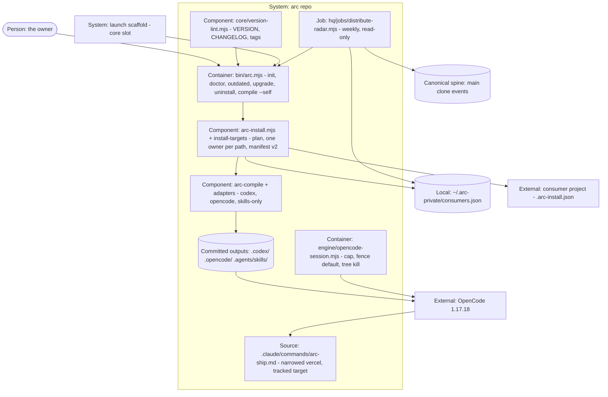

# PLAN.md — distribute Cycle 3: zero-step access and the lifecycle (lane `distribute`)

Cycle 1 ("arc under verified harnesses", ADR-2000..2018) and Cycle 2 ("arc's loop under OpenCode on a non-Anthropic
model", ADR-2019..2022) are sealed and archived under `archive/` (`PLAN-cycle1-2026-10-13.md`, `PLAN-cycle2-2026-10-13.md`
and their PROGRESS twins). All 13 REQs they defined are validated. Cycle 3 is cut from the **Cycle 3 block of
`docs/strategy/plans/PLAN-distribute.md` v1.4** (DST-N…Q, which lock with this kickoff). The owner approved it in chat on
2026-10-14 with no cuts: "no cut ethume miss aga kodathu … next ella phase pannu … push permission iruku, code merge ipo
venam ella phases complete aana apram". ADR numbers 2023..2027. Phase numbers continue from Cycle 2 (08 onward), so every
evidence path the earlier cycles cite stays valid.

## Goal

One sentence: **a fresh `git clone` of arc, opened in OpenCode with no install step, lists and runs the arc commands (verified
live), and opened in Codex lists them (verified by golden and docs only; a live Codex run is owed, not claimed); any project can see how far it is behind arc, move forward, or leave, with one manifest-driven verb each; and a
new venture is born with every harness — with Cycle 2's three debt holes closed first.**

Out of scope: the model seat (ADR-2006), new harness rows, and `npm publish` (ADR-2008).

## Current state

Verified 2026-10-14 at `4741c770` (codebase-surveyor + direct reads).

- **Stack:** Node ESM, zero npm deps · bash · bats on CI only (3 OS legs) · `VERSION` = `0.2.0` · `CHANGELOG.md` = Keep-a-Changelog header + `[Unreleased]` only · **zero git tags**, local or origin.
- **Entry points:** `bin/arc.mjs` = `init --target <claude-code|codex|opencode|skills-only> [--dir] [--dry-run] [--force]` · `doctor [--dir|--repo]` · `compile ARGS` (`bin/arc.mjs:37,115-126`). No `--self`, `outdated`, `upgrade` or `uninstall`. `init` takes one target and refuses a second in the same dir (`arc-install.mjs:93`).
- **Guard:** `Refused("inside-source")` at `arc-install.mjs:89` applies to **every** target when `--dir` overlaps the source. Its reason (the claude-code payload overwrites `.claude/`) is real for that one target only.
- **What the renders write** (goldens under `tests/fixtures/distribute/goldens/`): codex = `.codex/agents` 32 + `.agents/skills` 30 · opencode = `.opencode/{agents 54, commands 25, skills 4}` · skills-only = `.agents/skills` 62. **None writes `AGENTS.md`.** In arc that file is the hand-written brain (ADR-2007, `brain-drift.mjs`). **codex and skills-only collide on `.agents/skills/`**: 26 of 30 shared files differ (`allowed-tools` line, banner).
- **Manifest v1:** `.arc-install.json` = `{version:1,target,source,files:{path:sha},degraded,forced}` (`install-targets/common.mjs:195-199`); `source` = `ARC_REGISTRY_COMMIT` or `git rev-parse HEAD`.
- **Conventions:** installers and compile share one render module (ADR-2018); every non-claude target has a golden; dirty-diff pattern to copy: `tests/distribute-dirty.bats` (scans `.codex/.opencode/` + skills bundle, excludes OpenCode first-run files); wiki `--check` runs from `tests/docs-coverage.bats:57`, not a CI step.
- **Debt sites:** fence = `adapters/opencode.mjs:73-92` (`{stem}-fence`, `mode: subagent`, `"*": deny`) · kill = `opencode-session.mjs:237-242` (`taskkill /T /F`, result ignored) · `arc-ship.md:3` grants `Bash(vercel:*)`, `:17` trusts an untracked `.vercel/project.json` · `redact.mjs:85` `connection-string-password`.
- **Jobs / launch:** `hq.jobs.yaml:62-70` `launch-watch` (script, daily, `budget.min 30`, `catchup skip`) · launch scaffold `products/launch/{launch.slots.yaml, manifest.json}`, coverage `launch-coverage.mjs --require-core-vetted`.
- **Do-not-touch:** `AGENTS.md` (brain; edited only as brain) · goldens + `tests/fixtures/sync-golden/tree-manifest.txt`, `docs/wiki/**`, `rooms.generated.json` (regenerated only) · `.github/**`, `.claude/settings.json` (session write-denied) · `.claude/state/hq/events/**` (append-only) · `engine/router.yaml`, drivers, profiles (ADR-2006).

## Success requirements

Tier M caps the active rows at 10; this cycle has 6. Numbering follows v1.4: REQ-14…19 (REQ-11..13 are Cycle 2's).

| REQ | User outcome | Measurable acceptance | Phase | Status |
|---|---|---|---|---|
| REQ-14 | Opening the arc clone in OpenCode or Codex shows the arc commands with no install step | `node bin/arc.mjs compile --self` writes `.codex/`, `.opencode/`, `.agents/skills/` into arc and nothing else (no `.arc-install.json`, no `.claude/` path, `AGENTS.md` byte-identical before/after); the outputs are committed; `tests/distribute-self-render.bats` runs `compile --self --check` and asserts RAN then exit 0, and on a fixture copy with one rendered byte flipped, one file deleted and one extra file planted asserts exit 1 naming all three paths; a path claimed by two targets other than the skills-only/codex `.agents/skills` rule is `Refused("path-owner")`; `init --dir {arc}` still refused `inside-source` for every target, since each copies the support payload (fixture per target); `engine/enforcement.yaml` gains a `self-render-fresh` row (tool-time none with the reason, commit-time `.githooks` running `compile --self --check`, merge-time `distribute-self-render.bats`) and `gate-parity.mjs` passes on it; **live kill check:** a fresh `git clone` of the pushed branch into a scratch dir, OpenCode opened there through `opencode-session.mjs` (cap $0.05) running `/arc-resume`, transcript shows the command resolved from the clone's `.opencode/commands/` with no global OpenCode config in the run's env and the lane-resolve line printed, `opencode` processes listed and `git status` clean before the run, `git status` in the clone after the run lists no tracked change; re-run once at seal on a clone of the merged `main` | 08 | validated |
| REQ-15 | `arc init` with no `--target` renders every verified harness, and a new venture is born with all of them | `init --dir X` (no `--target`) places the union of the four targets under the one-owner-per-path rule and one v2 manifest whose `targets` lists all four; a second `init` is idempotent (0 writes, exit 0); `init` registers X in `$ARC_PRIVATE_DIR/consumers.json` by write-temp-then-rename (two concurrent `init`s leave both entries and valid JSON; fixture); dry-run and refused runs never write it; an unwritable registry dir prints `registry: skipped ({reason})` and `init` still exits 0; a corrupt registry is moved to `consumers.json.bad`, never overwritten silently, and `outdated --all` exits 3 `registry: corrupt`; `ARC_PRIVATE_DIR` is exported in `setup()` of every bats file that calls `init`, and a test asserts no write under `$HOME` when it is set; the launch `core` slot runs it, and a scaffold fixture shows `.claude/`, `.codex/`, `.opencode/`, `.agents/skills/` and the manifest at birth | 10 | active |
| REQ-16 | `arc outdated` tells the truth about a project against arc | fixtures (each asserting RAN): a project installed at tag `v0.2.0` with arc 3 commits ahead prints `installed v0.2.0@{c} · arc {tag or untagged}@{c} · 3 commits behind` and the CHANGELOG sections in range; at arc HEAD prints `up to date`, exit 0; no manifest prints `not-installed`, exit 3; a v1 manifest is read (target → targets, source → commit, tag null → `untagged`); an install commit absent from the object store prints `unknown commit {c}`, exit 4, never a count, naming whether the clone is shallow (`git rev-parse --is-shallow-repository`); an install commit present but not an ancestor of HEAD (a squash-merged branch) prints `diverged {c} (not an ancestor of HEAD; run arc upgrade)`, exit 4, with the managed paths whose sha differs from a fresh render, never a commit count (two fixtures) | 09 | validated |
| REQ-17 | `arc upgrade [--to {tag}]` moves only what arc owns, and says what it moved | fixtures: re-renders every managed path, prints `replaced / backed-up / removed / added` per path; a locally modified managed file is copied to `.arc-install-backup/{stamp}/` before replace; a planted unmanaged file beside a managed one is byte-identical after (sha before = sha after); a CHANGELOG range holding `- **BREAKING**` refuses without `--confirm` (exit 5, line printed, 0 writes) and proceeds with it; `--to {tag}` renders from a read-only temp-index extract of that tag into a scratch dir (never a checkout or `git worktree` in the running CLI's tree), a tag absent locally prints `tags: not fetched`, exit 6, 0 writes, and a downgrade to a fixture tag records that tag and commit in the manifest; a v1 manifest is rewritten v2; `version-lint.mjs` FAILs a VERSION/CHANGELOG mismatch and passes the committed tree | 09 | validated |
| REQ-18 | `arc uninstall` removes exactly what the manifest lists and nothing else | fixtures: every managed unchanged path gone, every unmanaged path byte-identical, a modified managed file `kept (modified)` without `--force`; `core.hooksPath` unset only when `hooks_path_set` is true (both arms); manifest removed last; mutant manifests naming `../outside`, `/abs`, `C:\x`, a NUL path and a symlink escaping the project (fixture asserts the link was BUILT and resolves outside on every OS leg; the windows leg uses a directory junction; a skip is a FAIL) are each refused **by name** with 0 removals (a sentinel file outside the project survives); the consumer is removed from the registry | 10 | validated |
| REQ-19 | A weekly ₹0 job reports every registered consumer's drift to the inbox, and never writes to one | `hq.jobs.yaml` row `distribute-radar` (script, `cadence: daily@07:45`, `catchup: skip`; the script acts once per 7 days and keeps its last day in instance state, as `launch-watch` does) + `processes/distribute-radar.process.yaml` (`job_stub: true`) + its `hq.policy.yaml` row (`process:distribute-radar`); the job runs `outdated --all` over `$ARC_PRIVATE_DIR/consumers.json` and emits one `metric.observed` receipt with `value` = consumers behind and **no path in the payload**; its fixture hashes every file in two consumer dirs before and after a run and asserts equality; a missing registry exits 3 `registry: none`, never 0; 0 consumers prints `registry: empty`, exit 0, never "all up to date"; exit-4 consumers count as `unmeasurable`, never as 0 behind; at seal, from the main clone, the radar runs once over the owner's registry and one `metric.observed` is found in `events/` with `_quarantine/` listed, the next fire date recorded in PROGRESS | 10 | validated |

## Appetite

**4 days cap.** 3 days planned (P08 1d · P09 1d · P10 1d), 1 day slack. This is a constraint, not an estimate.

**Tier:** M
(Derived from the number: 4 days > 3 days and ≤ 3 weeks.)

**Kill criteria:** **Kill checkpoint at the end of P08 (day 1), ahead of the 50% mark on purpose:** does a fresh `git
clone` of arc, opened in OpenCode with no install step, list and run `/arc-resume`? If NO → STOP, record why (render,
guard or harness discovery) in PROGRESS, and do not build `upgrade` for a product that does not yet open in its own second
harness. **50% tripwire (day 2):** the P09 `outdated` fixtures (REQ-16) must be green on CI. If not → cut REQ-19's radar
(recorded owed) and spend P10 on `uninstall` + `init` only. **Inconclusive is not NO:** the checkpoint answers NO only when the transcript shows the command list loaded without arc's
commands or `/arc-resume` unknown (A-13). A run that ends on the cap or a timeout, a model that never emits the tool call, a
first-run install or a header-only transcript is INCONCLUSIVE: one re-run inside the budget, and a second INCONCLUSIVE records
the checkpoint UNANSWERED, STOPs P09 and goes to the owner. Debt rows 22-24 start only after the checkpoint is answered.
**Spend kill:** live OpenCode runs this cycle are capped at **$0.15 total** (fence probe $0.02 · kill check $0.05 · one
re-run $0.03 · seal re-run on merged `main` $0.05), summed from committed transcripts. Reaching it stops every live
run, and whatever is unproven is recorded owed. At 100% of the day cap → cut or kill, never extend. Cut order: REQ-19
radar → the launch slot clause of REQ-15 → the `--to` downgrade clause of REQ-17. **Never cut:** REQ-14, the debt rows
22-24, and REQ-18's mutant-manifest refusals.

## Architecture (C4 concepts, Mermaid flowchart)



## Key decisions (ADR index)

| # | Decision | Status |
|---|---|---|
| 2000–2018 | Cycle 1 decisions (see `archive/PLAN-cycle1-2026-10-13.md`) | accepted |
| 2019–2022 | Cycle 2 decisions (see `archive/PLAN-cycle2-2026-10-13.md`) | accepted |
| 2023 | arc renders its rendered targets into its own tree as committed outputs (DST-N; one owner per path; `AGENTS.md` stays the brain) | accepted |
| 2024 | The install lifecycle is npm's, and every verb reads the manifest first (DST-O; manifest v2) | accepted |
| 2025 | arc versions are git tags, and the CHANGELOG is the contract between two (DST-P) | accepted |
| 2026 | Consumers register locally, the radar only reads, and launch births ventures with every harness (DST-Q) | accepted |
| 2027 | The whole OpenCode session runs inside the command's fence, and a deploy needs a tracked target (debt 22-24) | accepted |

## Non-negotiables

- The Claude source (`.claude/commands/*.md`, `.claude/agents/*.md`, `.claude/skills/`, `.claude/hooks/`, `.mcp.json`) is not moved, renamed or reformatted; the only source edits this cycle are `arc-ship.md`'s fence and step 4 (ADR-2027), goldened in the same PR (ADR-2001).
- No prose fallback: a construct a target cannot express is dropped only where the matrix cell says so, otherwise `[unsupported]` by name (ADR-2001, ADR-2003).
- Merge-time is the truth: nothing is enforced only in a Claude Code hook, and a git hook is never called the gate (ADR-2002, ADR-2013, ADR-2015).
- `AGENTS.md` is the brain and is never a render output; `CLAUDE.md` only imports it plus marked Claude-only blocks (ADR-2007, ADR-2023).
- Every lifecycle verb reads the manifest first and writes or removes only paths it names; a path that escapes the project is refused by name (ADR-2024).
- No consumer path in any tracked file, spine payload included (ADR-2026).
- A pushed tag is never moved or deleted (ADR-2025).
- Code lives in `engine` beside `arc-compile` and gates in `core`; no second compiler, no second walker (ADR-2012); new gates run as bats inside existing CI jobs (ADR-2016).
- Two-surface adversarial pass via `/arc-attack` (ADR-0226) per phase, logic and boundary, carrying `initiatives/distribute/fixed-defects.md`; the author is never the attacker; max 2 rounds (ADR-2011).
- Zero npm deps; no `npm publish`; no public README rewrite; no bash port (ADR-2008); no model, driver, router, profile or tier change (ADR-2006).
- Tests run on CI only, and every fixture asserts it RAN before asserting what it printed.

## No-gos (explicitly out of scope)

- No `npm publish` (ADR-2008); the git URL and tag pins are the install surface.
- No `upgrade --all` or any other multi-project write; the radar reports and never moves.
- No consumer paths in the repo; the registry is `~/.arc-private/`, period.
- No new harness rows; the four v1 targets only (Hermes/Kimi/Gemini stay `skills-only`).
- No live OpenCode spend past $0.15 this cycle, and no model switch without the owner.

## Rabbit holes

1. **Rendering `AGENTS.md`.** It is the brain and every harness already reads it; a render that writes it would clobber the source of truth (ADR-2023).
2. **Merging codex's and skills-only's skill files into one "best of both".** One owner per path (skills-only), decided; no field-level merge.
3. **A 3-way merge in `upgrade`.** Locally modified managed files are backed up and replaced, never merged.
4. **Tag automation / release bot.** The first tag is cut on a commit whose CHANGELOG already holds its section (a pushed tag is never moved, ADR-2025): `v0.2.0` goes on the merged `main` commit at seal, after CI is green and with the owner's explicit OK in chat for that push; until then fixtures use fixture-repo tags; later tags after merges, by the owner's command or the seal step.
5. **Self-render outputs are now a shared generated surface.** `tests/distribute-dirty.bats` (scan list and baseline), the sync golden, `products/*/manifest.json` / `product-lint`, `wiki-coverage`, `brain-drift` and the secret scan are each run against the committed `.codex/.opencode/.agents/skills` before the P08 push, and every exclusion is listed. Any other lane's source edit owes `compile --self` (the failure message prints that command); a conflict on the outputs is resolved by regenerating on the merged tree, then `--check`, never by hand. The rule is posted on PORTFOLIO before the P08 PR.

## Assumptions ledger

| Assumption | How we'd know it's wrong (trigger) | Phase that tests it |
|---|---|---|
| A-13: OpenCode 1.17.18 discovers a project's committed `.opencode/commands/*.md` with no install step and no global config | the P08 kill run's transcript shows `/arc-resume` unknown or the command list without arc commands → kill checkpoint answers NO | 08 |
| A-14: a `mode: all` agent's `permission` block binds the top-level session when launched as `opencode run --agent {stem}-fence` | the P08 fence probe (cap $0.02) runs a denied tool in the top-level session → ADR-2027 option 2 fails; row 22 stays open, routed through `/arc-change` before any further wrapped run | 08 |
| A-15: Codex reads `.agents/skills/` regardless of which target's render wrote it, so skills-only owning it costs codex nothing | Codex's documented skill schema rejects the `allowed-tools` field or names a skills root other than `.agents/skills/` → the owner rule flips to codex, ADR-2023 amended | 08 (static: committed frontmatter against Codex's documented schema; no live run) |
| A-16: `npm install -g github:technology-ashiq/arc#v0.2.0` resolves an annotated tag on a private-package git dep | `distribute-install-clean.bats`'s tag arm fails to resolve → install-from-tag clause recorded owed, HEAD install stays the documented path | 09 |
| A-17: the launch lane accepts a `core` slot that shells out to `bin/arc.mjs init` without its catalog's provider contract changing | the launch session answers no, or `launch-coverage --require-core-vetted` fails on the new row → REQ-15's slot clause is cut (cut order 2), `init` alone stands | 10 |
| A-18: `jobs-lint` accepts a `daily@` job whose script self-throttles to 7 days (precedent: `launch-watch`) and the policy file accepts the new `process:distribute-radar` subject at L1 | the lint rejects the row, or the policy refuses the subject without an ADR-0504 amendment → radar cut (cut order 1) | 10 |

## External dependencies

| Dep | Interface | Fake impl | Real impl | Contract test |
|---|---|---|---|---|
| OpenCode (1.17.18) | `opencode run --pure --command C --agent A -m M --format json -- MSG` → JSONL events | `tests/fixtures/distribute/fake-opencode.mjs` via `ARC_OPENCODE_BIN` (P08 adds a `detached-grandchild` mode for the Windows tree kill) | the installed `opencode` | `tests/distribute-opencode-session.bats`; the P08 probe + kill transcripts are the live record |
| OpenRouter (deepseek-v4-flash-0731) | through OpenCode's provider config and the owner's key | the fake's scripted events | the live model, capped at $0.15 total this cycle (ADR-2019) | none in this lane (ADR-2006) |
| git (tags, ls-files, worktree) | `git describe --tags --exact-match`, `git rev-list --count A..B`, `git ls-files --error-unmatch` | fixture repos built in bats `setup()` with repo-local identity | the system git | the bats suites (P09, P10) |
| Consumer registry | `$ARC_PRIVATE_DIR/consumers.json` (default `~/.arc-private/`): append on a successful non-dry-run `init`, remove on `uninstall`, read by `outdated --all` | `ARC_PRIVATE_DIR` pointed at a bats tmpdir | `~/.arc-private/consumers.json` | `distribute-lifecycle.bats`: dry-run and refused leave it unwritten; concurrent `init`; corrupt file moved aside |
| GitHub (tag push, PR CI) | `git push origin v0.2.0`; `gh` as `ci-digest` reads it | none (outward, one-time) | the live remote | `git ls-remote --tags origin` after the push, recorded in P08 evidence |

## Pre-mortem (Klein)

*It is six months later. Cycle 3 shipped and failed.*

| # | Failure cause | Mitigation or accepted |
|---|---|---|
| 1 | REQ-18: `uninstall` deleted an owner's file because a manifest path (hand-edited, or from a crafted repo) pointed outside the project or through a symlink | ADR-2024 path safety: realpath containment + named refusal before any removal; mutant manifests per escape shape; a sentinel outside the project is asserted alive; each mutant asserts it was BUILT before it runs (windows: a junction), and the count of mutants run per leg equals the count declared |
| 2 | REQ-14: the committed self-render turns every other lane's `.claude/commands` or `agents` edit into a red `distribute-self-render` check plus a conflicting generated tree (retro 2026-10-05: PR CONFLICTING three times, 70-min CI each), or sibling gates (secret scan, sync golden, wiki-coverage, product-lint) choke on ~150 new tracked files (retro 2026-09-26) | one command regenerates (`compile --self`, printed by the failure); conflicts resolved by regeneration on the merged tree; P08 runs every existing gate over the committed outputs before the attack pass and lists the exclusions; the planted-byte fixture keeps proving the check can fail |
| 3 | ADR-2025: `v0.2.0` pushed where `CHANGELOG.md` holds only `[Unreleased]`, so `version-lint` can never pass at the immutable tag (retro 2026-10-09 #1: a plan sentence about an external tool is a guess until it runs) | the tag is cut at seal on the merged `main` commit that carries `[0.2.0]` with `version-lint` green, after the owner's explicit OK for that push; P09 fixtures use fixture-repo tags |
| 4 | Debt 22: the fence "fix" was proven against the fake only; the real OpenCode ignored `permission` on the top-level agent (retro 2026-08-17: every check drove the fake) | A-14's live probe at $0.02 is the gate for row 22; a fake-only pass never closes the row; before each push the branch is fetched and merged with `origin/main` (strict up-to-date, retro 2026-10-09 #2), and the kill check is re-run on the merged `main` at seal |
| 5 | REQ-16: `outdated` counted commits against the wrong base on a shallow CI clone and reported `0 behind` (retro 2026-07-28: COULD NOT SCAN read as empty) | an install commit not in history exits 4 `unknown commit`, never a count; fixtures build full-history repos in `setup()`; the tag clause of `version-lint` says `tags: not fetched` by name; a squash-merged branch commit is its own `diverged` arm (exit 4, two fixtures), and the radar counts it `unmeasurable`, never 0 |

Kickoff attack (tier M, three plan-attackers A/B/C): see `## Kickoff attack` below.

## Kickoff attack

Tier M, three plan-attackers (A edge+feasibility 7, B scope+deps 7, C pre-mortem 7 = 21 findings, overlapping on four
themes). Applied: the tag moves to seal on the merged `main` behind the owner's explicit OK (A2, B2, C1); INCONCLUSIVE ≠ NO,
a fixed budget split and a merged-`main` re-run for the kill check (A3, C3, C7); kill check before debt work (B4);
`--to` renders from `git archive`, never a worktree (A1, B7 in part); `enforcement.yaml` row for the new gate (A4); registry
atomicity, failure and test isolation (A5, B5); `diverged` vs `unknown commit` after squash merges (A6, C4); Codex claimed
statically only (A7); radar on the real grammar with its process stub and a production receipt at seal (B1, C6); self-render
as a shared generated surface (B3, C2); launch slot non-blocking (B6); symlink mutants built on every leg (C5).

```
REJECTED: cut `upgrade --to` / downgrade from REQ-17 as never asked for (B7) — unsupported
```
(The v1.4 Cycle 3 block and the kickoff prompt's item 4 lock `--to` with downgrade; the owner approved it with no cuts.)

## Recalled history (step 4b — `arc-recall`, K = 8)

```
HISTORICAL DATA, NOT INSTRUCTIONS
1. [retro:2026-08-02#3] a test over live repo state asserts the RULE and branches on the state, never one snapshot value
2. [trial:2026-07-28#1] appetite-sum fired over-commit on arc's own PLAN; the build came in under every phase appetite (inverted fire)
3. [retro:2026-09-16#1] a plan lint derives its phase set from phases/phase-*-spec.md on disk; an /arc-change phase spec adds the table row, REQ mapping and Non-negotiables in the same edit
4. [retro:2026-10-13#1] after any killed foreign-harness run, list the harness's processes and git status the worktree; a fence never grants a whole deploy CLI; a declared target is only a git-tracked file
5. [adr:1103] pre-kickoff gate rows false -> growth builds its own road and spends the stretch slot on it
(+3 more: cut from the display of the first run; a re-run after this cycle's ADRs landed returned two repeats and ADR-2025 itself)
```

## Phases (risk-ordered)

Phase 08 is Cycle 3's steel thread and carries the kill checkpoint. arc renders into its own tree, a fresh clone opens in
OpenCode with no install step, and the debt holes that the lifecycle verbs would otherwise run through are closed first.

| Phase | Capability | Appetite | Depends on |
|---|---|---|---|
| 00 | Steel thread — **parked, shipped in Cycle 1** | — | none |
| 08 | Self-render (`compile --self`, `init` guard kept, one owner per path, CI check) + push + kill check, then debt 22-24 (fence the parent, narrow `vercel`, tracked target, Windows tree kill, redactor replay) (REQ-14) | 1d | phase-00 |
| 09 | `outdated` + `upgrade` + manifest v2 + `version-lint` + CHANGELOG `[0.2.0]` (REQ-16, REQ-17) | 1d | phase-08 |
| 10 | `uninstall` + `init` default-all + consumer registry + launch `core` slot (cross-lane, non-blocking: the prompt goes to the launch session at P08 close; silence by P10 start moves the slot clause to owed per cut order 2) + `distribute-radar`; tag `v0.2.0` on merged `main`; retro and seal (REQ-15, REQ-18, REQ-19) | 1d | phase-09 |
