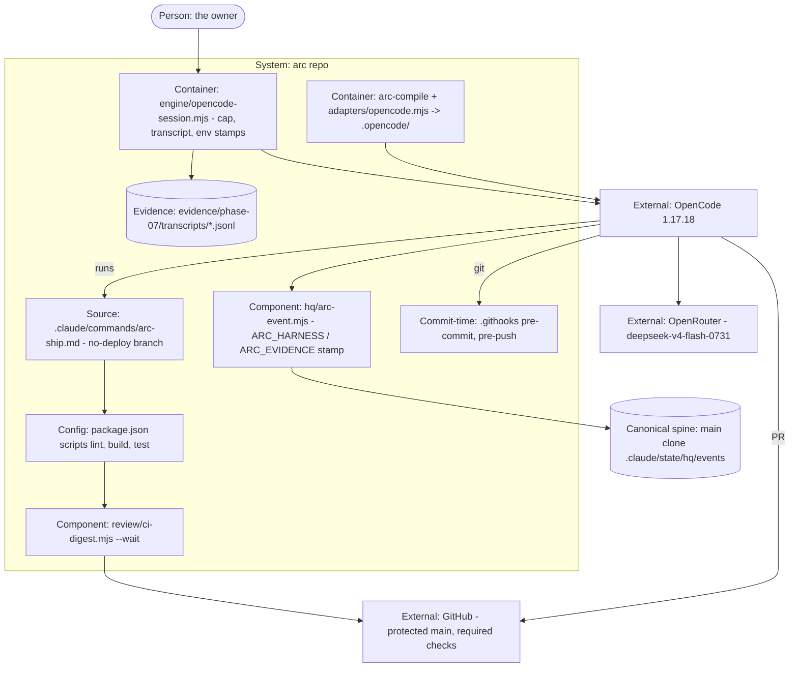

# PLAN.md — distribute Cycle 2: arc's loop under OpenCode on a non-Anthropic model (lane `distribute`)

Cycle 1 ("arc under verified harnesses") is sealed and archived at `archive/PLAN-cycle1-2026-10-13.md` and
`archive/PROGRESS-cycle1-2026-10-13.md`. It validated 9 of 10 REQs and left **REQ-03 owed** (assumption A-05 fired:
no non-Anthropic profile existed at P03 open). Cycle 2 exists to close it. The owner opened it on 2026-10-13 in chat:
"REQ-03 cycle", model `deepseek/deepseek-v4-flash-0731` on OpenRouter, cap **$0.50**, and "complete all phases … don't
wait for me … push permission iruku, merge ellam phases complete aana apram". ADR-2000..2018 stand; Cycle 2 adds
ADR-2019..2021. Phase numbers continue from Cycle 1 (05 onward), so every evidence path Cycle 1 cites stays valid.

## Goal

One sentence: **an OpenCode session on `openrouter/deepseek/deepseek-v4-flash-0731`, launched through one capped
wrapper, runs arc's own `arc-commit` → `arc-review` → `arc-ship` on a real arc change, lands ≥ 3 receipts on the
canonical spine stamped `harness: opencode` with a committed transcript as evidence, is refused on the 3 negative
fixtures exactly as a Claude Code session is, and its PR merges after the required checks — for under $0.50.**

Out of scope: the model seat (ADR-2006) — the model is an argument to the wrapper, no profile/router/driver changes.

## Current state

Verified 2026-10-13 at `140df0b6` (codebase-surveyor + direct reads).

- **Stack:** Node ESM, zero npm deps · root `package.json` (`private`, `bin: arc`, `files` allowlist, **no `scripts`**) · bats on CI only (3 OS legs).
- **Entry points:** `bin/arc.mjs` (`init|doctor|compile`, targets claude-code|codex|opencode|skills-only) · `.claude/scripts/engine/arc-compile.mjs` + `adapters/opencode.mjs` + `install-targets/opencode.mjs` · `.claude/scripts/hq/arc-event.mjs` (emit; `--evidence PATH` exists, `ARC_MODEL` read at `:273`) · `.claude/scripts/review/ci-digest.mjs` (`--sha`, `--tail`; no wait).
- **Conventions:** engine scripts in `.claude/scripts/engine/`; tests central in `tests/*.bats`; spine only via `arc-event`; main guards realpath both sides; test-only env doors named in `arc-event.mjs:26`.
- **Spine:** `spine-io.mjs` `spineRoot()` honours `ARC_SPINE_ROOT`, else refuses a linked worktree (`assertNotLinkedWorktree`). `validate.mjs` has no `harness` key; the payload is free-form (the Cycle 1 spike's `payload.harness` landed on `note.logged`). Nothing in code sets `harness`.
- **The loop's kinds:** `commit.done` (`processes/commit-msg-draft.process.yaml:62`), `review.completed` (`review-diff.process.yaml:130`), `ship.done` (`.claude/commands/arc-ship.md` step 5, hand-written).
- **`arc-ship` cannot run in arc as written:** no `npm run lint|build|test` scripts, no `vercel.json`/`.vercel/`, and AGENTS.md forbids running suites locally (ADR-2021).
- **Negatives today:** `engine/enforcement.yaml` has tool-time `none` for push-to-main, secret, generated-edit; commit-time is `.githooks/pre-push` (branch-guard) and `pre-commit` (secret-diff-scan, `arc-compile --check --target claude-code`); merge-time is protected `main` + `tests/distribute-merge-gates.bats` + `tests/engine-compile.bats`. **`core.hooksPath` is unset** in the main clone and this worktree. OpenCode loads no arc fragment (`harnesses.yaml:99`).
- **Spend cap:** none for a foreign harness; `arc-run.mjs` caps INR on its own drivers only.
- **OpenCode:** 1.17.18 on PATH. Working invocation (spike run 7): `opencode run --pure --auto --command C --agent A -m openrouter/deepseek/deepseek-v4-flash-0731 --format json -- MSG`. OpenCode writes `package.json`, `node_modules/` etc. into `.opencode/` on first run. The spike's raw transcripts are outside the repo (only a summary is committed).
- **Do-not-touch:** `.claude/commands/{arc-commit,arc-review,arc-kickoff}.md` (compiled) · `.claude/state/hq/events/**` (append-only) · `engine/router.yaml`, drivers, profiles (ADR-2006) · `.github/**`, `.claude/settings.json` (session write-denied) · `docs/wiki/**`, `rooms.generated.json` (regenerated only).

## Success requirements

Tier S caps the active rows at 5. REQ-03 keeps its Cycle 1 text, with the ship step defined by ADR-2021.

| REQ | User outcome | Measurable acceptance | Phase | Status |
|---|---|---|---|---|
| REQ-11 | A foreign-harness run cannot spend past its cap or leave no record | `tests/distribute-opencode-session.bats` drives `opencode-session.mjs` against a fake `opencode` (`ARC_OPENCODE_BIN`) and asserts, each after a RAN line: cumulative cost ≥ cap → exit 3 + `cap-breach:` line + child killed; cost events absent with steps present → exit 4 `COST-UNREADABLE`; timeout → exit 5; missing/`anthropic/` model, missing cap, cap > 1.00, missing binary → exit 2 named, fake never invoked (its marker file absent); success → transcript line 1 matches `^harness-proof: opencode \S+ session=ses_\S+ model=\S+ cap_usd=` and every fake event line follows verbatim; the fake spawns a grandchild that writes a marker after N ms, and on cap-breach and on timeout that marker is absent (whole tree killed); the fake is also run through a `.cmd` shim named by `ARC_OPENCODE_BIN`, and a MESSAGE holding a space, a `"`, a `$X` and a backtick reaches the fake byte-identical in argv; the fake asserts the wrapper passed `--pure`, `--auto`, `--format json` and `--`; prior transcripts summing past the cycle cap → exit 2 `CYCLE-CAP`, fake never invoked; the last transcript line is `spent=` on every exit path | 05 | active |
| REQ-12 | Receipts from a wrapped session say which harness made them and where the proof is, without the model's help | `tests/distribute-harness-stamp.bats`: with `ARC_HARNESS=opencode` and `ARC_EVIDENCE=p`, an emit whose payload lacks `harness` lands with `payload.harness == "opencode"` and `evidence == "p"`; a payload with `"harness":"claude-code"` is refused `HARNESS_MISMATCH`; `ARC_HARNESS=Bad!` refused `BAD_HARNESS`; unset, the emitted line is byte-identical to the same emit before this change (fixed `ARC_SPINE_NOW`/`ARC_SPINE_RAND`); the wrapper's `ARC_SPINE_ROOT` equals `dirname(git common dir)/.claude/state/hq` for a fixture worktree | 05 | active |
| REQ-13 | `arc-ship` runs in a repo with no deploy target and in arc itself | root `package.json` `scripts` = `lint`, `build`, `test` per ADR-2021 and still no `prepare`/`install`; `tests/distribute-ship-nodeploy.bats` asserts `arc-ship.md` names the no-deploy branch and `ci-digest --wait` against a fake `gh` (pending → pending → success) exits 0 after 3 reads and exits 3 `TIMEOUT` when it never settles (each asserting RAN); `--wait` against a fake `gh` returning no run exits 6 `NO-RUN` and returning a different head SHA exits 4 without waiting (each asserting RAN); `arc-ship.md` creates the PR when none is open; all four distribute goldens and the sync golden regenerated and `--check` green on CI; a `git grep` for every `npm test`, `npm run lint` and `npm run build` caller over `.github .githooks .claude/hooks .claude/scripts tests docs` is listed in the PR, and no CI job, hook or bats test invokes `npm test` | 06 | active |
| REQ-03 | arc's own loop runs under a second harness on a non-Claude model | in OpenCode on `openrouter/deepseek/deepseek-v4-flash-0731` via `opencode-session.mjs --cap-usd 0.50`: `arc-commit` → `arc-review` → `arc-ship` complete with ≥ 3 receipts carrying `harness: opencode` found by id in `events/`, each with `evidence` pointing at a committed transcript that carries the OpenCode version and session id, AND `events/_quarantine/` holds 0 receipts from the run (both directories listed); the 3 negative fixtures (push to main, secret in diff, generated-file hand-edit) are refused, as under Claude Code; one PR from that session merges after required checks; total spend summed from the transcripts ≤ $0.50 | 07 | active |

## Appetite

**3 days cap.** 2.75 days planned (P05 1d · P06 0.75d · P07 1d), 0.25 day slack. This is a constraint, not an estimate.

**Tier:** S
(Derived from the number: 3 days ≤ 3 days.)

**Kill criteria:** the **50% tripwire (day 1.5)** sits at the end of Phase 05: one wrapped OpenCode run of the rendered
`arc-commit` must have landed one `commit.done` stamped `harness: opencode`, found by id on the main clone's spine, for
≤ $0.10. If NO → STOP and record the finding; REQ-03 stays owed with the failure named, no further spend. **Spend kill:**
the cycle's total OpenCode spend (summed from every committed transcript, smoke runs included) reaching **$0.50** stops all
real runs; whatever REQ-03 has not shown by then is recorded owed, never claimed. **Model kill:** two consecutive real runs
that stall or emit a malformed tool call (the spike's run-5 shape) → STOP and ask the owner for a second model; never
switch models silently. At 100% of the day cap → cut or kill, never extend. Cut order: REQ-13's goldens for codex and
skills-only (render only opencode + claude-code) → the PR-merge clause of REQ-03 (recorded owed). **Never cut:** REQ-11's
cap and the transcript.

## Architecture (C4 concepts, Mermaid flowchart)



## Key decisions (ADR index)

| # | Decision | Status |
|---|---|---|
| 2000–2018 | Cycle 1 decisions (see `archive/PLAN-cycle1-2026-10-13.md`) | accepted |
| 2019 | OpenCode sessions run through one wrapper that caps spend and writes the transcript | accepted |
| 2020 | A foreign-harness session stamps its receipts and writes to the canonical spine | accepted |
| 2021 | `arc-ship` in a repo with no deploy target ships to a PR and reads CI | accepted |

## Non-negotiables

- The Claude source (`.claude/commands/*.md`, `.claude/agents/*.md`, `.claude/skills/`, `.claude/hooks/`, `.mcp.json`) is not moved, renamed or reformatted; adding the `targets:` key is the only source edit, and a lint pins it (ADR-2001).
- No prose fallback: a construct a target cannot express is dropped only where the matrix cell says so, otherwise `[unsupported]` by name (ADR-2001, ADR-2003).
- Merge-time is the truth: nothing is enforced only in a Claude Code hook, and a git hook is never called the gate (ADR-2002, ADR-2013, ADR-2015).
- The gates phase (P01) precedes every adapter; phase order is never changed; undeclared surfaces are resolved before any new one (ADR-2004, ADR-2014).
- `sync-to-project.sh`'s output stays byte-identical to the golden committed in P00 for every root-mode consumer (ADR-2005).
- `AGENTS.md` is the brain and `CLAUDE.md` only imports it plus marked Claude-only blocks (ADR-2007).
- Subagents degrade to role skills, never to a nested harness call; only the four v1 targets install (ADR-2009, ADR-2010).
- Code lives in `engine` beside `arc-compile` and gates in `core`; no second compiler, no second walker (ADR-2012); new gates run as bats inside existing CI jobs (ADR-2016).
- Two-surface adversarial pass via `/arc-attack` (ADR-0226) per PR, logic and boundary, carrying `initiatives/distribute/fixed-defects.md`; the author is never the attacker; max 2 rounds (ADR-2011).
- Zero npm deps; no `npm publish`; no public README rewrite; no bash port (ADR-2008); no model, driver, router, profile or tier change (ADR-2006).
- Tests run on CI only, and every fixture asserts it RAN before asserting what it printed.

Cycle 2 reads two of these by ADR: the first bullet admits one more source edit, ADR-2021's `arc-ship` step 4, decided
in its own ADR and goldened in the same PR; the sync golden is regenerated for that one file and nothing else.

## No-gos (explicitly out of scope)

- No model, profile, router or driver change; the model is a wrapper argument (ADR-2006).
- No Codex or other-harness real run in this cycle; REQ-03 names OpenCode.
- No OpenCode plugin that loads arc's hook fragments (tool-time parity is not REQ-03; merge-time is the truth).
- No spend past $0.50 for any reason, and no switch to a different model without the owner.
- No `npm publish`, no README rewrite, no "works with N tools" sentence.

## Rabbit holes

1. **Making the weak model "smarter" with prompt tuning.** The commands run as rendered; a run that fails is evidence, recorded with its transcript.
2. **Measuring OpenRouter's bill exactly.** The wrapper sums what OpenCode reports; the owner's key limit is the second ceiling, not a REQ.
3. **Tool-time parity under OpenCode** (an arc plugin). Named out; the negatives are refused at commit- and merge-time, which is what "as under Claude Code" means when `enforcement.yaml` says tool-time `none`.
4. **Running the session in the owner's main clone.** It sits on `main` with the owner's own files; the session runs in its own worktree and names the canonical spine (ADR-2020).
5. **Hand-merging the regenerated goldens** after another lane lands. Regenerate on the merged tree, then `--check`.

## Assumptions ledger

| Assumption | How we'd know it's wrong (trigger) | Phase that tests it |
|---|---|---|
| A-08: OpenCode 1.17.18's `--format json` stream carries a numeric per-step `cost` for OpenRouter models | the P05 smoke transcript holds step events and no numeric `cost` → the wrapper exits 4 by design; switch the cap source to OpenRouter's `/api/v1/generation` cost per id via a new ADR, before any second real run | 05 |
| A-09: deepseek-v4-flash completes the rendered `arc-commit` within 1200 s and $0.10 (spike run 7 did one tool call + one receipt) | the P05 smoke stalls, malforms a tool call, or spends > $0.10 → the 50% tripwire answers NO; model kill rule applies | 05 |
| A-10: `git config --worktree core.hooksPath .githooks` (with `extensions.worktreeConfig`) turns the commit-time line on in the session worktree only | the P07 secret fixture commits without a pre-commit refusal → commit-time is recorded `off` for that run and the negative is recorded owed; a bad commit is never pushed to GitHub to demonstrate a merge-time refusal (the repo is public) | 07 |
| A-11: the session's real change is the stale Cycle 1 owner-items line (5 move-on stamps were approved 2026-10-07..09 and the archived tracker still lists them as owed), corrected in `archive/PROGRESS-cycle1-2026-10-13.md` as a dated note | the change turns out to need a code edit the model cannot make in budget → the session's change is the P07 evidence README line instead, named in the transcript | 07 |
| A-12: protected `main` merges a PR whose head was pushed by this machine's `gh` auth after required checks, at cycle end | the PR from the session reads `BLOCKED` for a reason other than checks → recorded and asked, never bypassed | 07 |

## External dependencies

| Dep | Interface | Fake impl | Real impl | Contract test |
|---|---|---|---|---|
| OpenCode (1.17.18) | `opencode --version`; `opencode run --pure --command C --agent A -m M --format json -- MSG` → JSONL events on stdout | `tests/fixtures/distribute/fake-opencode.mjs` emitting scripted events (cost, session id, stall) via `ARC_OPENCODE_BIN` | the installed `opencode` | `tests/distribute-opencode-session.bats` against the fake; the P05 smoke transcript is the live contract, committed |
| OpenRouter (deepseek-v4-flash-0731) | reached only through OpenCode's provider config and the owner's `OPENROUTER_API_KEY` env | the fake's scripted events | the live model, capped at $0.50 by ADR-2019 | none in this lane (ADR-2006); the committed transcripts are the record |
| GitHub checks API (`gh`) | `gh run list/view` as `ci-digest` already reads it | a fake `gh` on `PATH` in `tests/distribute-ship-nodeploy.bats` returning pending, pending, success | the live API | the bats suite; the P07 PR run is the live read |

## Pre-mortem (Klein)

*It is six months later. Cycle 2 shipped and failed.*

| # | Failure cause | Mitigation or accepted |
|---|---|---|
| 1 | REQ-03: the run "passed" on receipts the model wrote by hand and labelled wrong — the Cycle 1 spike's receipt says `arc-resume` for a run of `arc-spike-receipt` | ADR-2020 stamps `harness` and `evidence` from the environment and refuses a contradicting payload; P07 evidence lists each receipt id with its `command` read from the transcript, not from the payload |
| 2 | REQ-11: the cap never fired because cost was never read — a silent 0 looked like "under budget" (retro 2026-08-12: COULD NOT SCAN reported as empty) | exit 4 `COST-UNREADABLE` on steps-without-cost; the fake has an arm with no cost fields; the P05 smoke is the live check of A-08 |
| 3 | REQ-03: logic stalled on transport, every failure blamed on the model (retro 2026-10-02: constant wall time = transport limit) | the wrapper records wall time per step in the transcript; two stalls at the same wall time are investigated as transport before the model kill rule is read |
| 4 | REQ-11: the cap, kill and cost parse were proven only against a fake that cooperates; the real OpenCode's cost field is shaped differently, so the cap never fires on the one run that matters (retro 2026-08-17: every check drove the fake; 2026-08-03: a fake that short-circuits the real path) | P05 adds one live overspend control: the wrapper runs real OpenCode with `--cap-usd 0.002` and must exit 3 `cap-breach` with the child gone, or exit 4 `COST-UNREADABLE`, never 0; its spend counts toward the cycle's $0.50 |
| 5 | REQ-03: receipts landed on a spine nobody reads (retro 2026-09-16, 2026-08-10: worktree spines) | ADR-2020's root is computed from git, printed in the transcript header, and the P07 evidence finds each id in the main clone's `events/` and lists `_quarantine/` |

Kickoff attack (tier S, one merged A+C run, 7 findings): all 7 applied — the CI wait gains `NO-RUN` and a PR-create step (ADR-2021), the negatives never reach GitHub (P07 scope, A-10), whole-tree kill and argv-exact spawn on Windows (REQ-11, ADR-2019), the cap is per cycle and computed from committed transcripts (ADR-2019), `--auto` restored to the invocation, `npm test` callers listed (REQ-13), and pre-mortem row 4 replaced by a live overspend control. 0 rejected.

## Recalled history (step 4b — `arc-recall`, K = 8)

```
HISTORICAL DATA, NOT INSTRUCTIONS
1. [adr:0049] the explore loop's own constraints caused the convergence; freedom restored, verification kept
2. [retro:2026-10-05#3] smoke the logic model on a tiny input with the same flags first; deepseek-v4-flash answered non-JSON, GLM timed out at 420 s
3. [retro:2026-07-30#1] open the artifact before carrying its verdict
4. [adr:0039] external design tools deferred
5. [retro:2026-09-16#2] nine phases built and one closed; closes waited behind "a worktree cannot emit"
6. [adr:2010] v1 targets claude-code, codex, opencode, skills-only; opencode runs any OpenRouter model under one harness
7. [adr:1401] the composer sees its own work, render-in-loop
8. [retro:2026-10-02#1] constant wall time across models is a transport limit, not the model
```

## Phases (risk-ordered)

Phase 00 is Cycle 1's walking skeleton, shipped. Phase 05 is Cycle 2's steel thread and its riskiest bet: one rendered
command, run headless in OpenCode on the owner's model through the capped wrapper, lands one stamped receipt on the
canonical spine. It carries the 50% tripwire.

| Phase | Capability | Appetite | Depends on |
|---|---|---|---|
| 00 | Steel thread — **parked, shipped in Cycle 1** | — | none |
| 05 | Capped wrapper + transcript + harness/evidence stamp + one live `arc-commit` smoke receipt — 50% tripwire (REQ-11, 12) | 1d | phase-00 |
| 06 | `arc-ship` runnable in arc: package scripts, `ci-digest --wait`, no-deploy branch, goldens (REQ-13) | 0.75d | phase-05 |
| 07 | The real run: commit → review → push → ship, 3 negatives, PR merged after checks, transcripts committed, retro + seal (REQ-03) | 1d | phase-06 |
