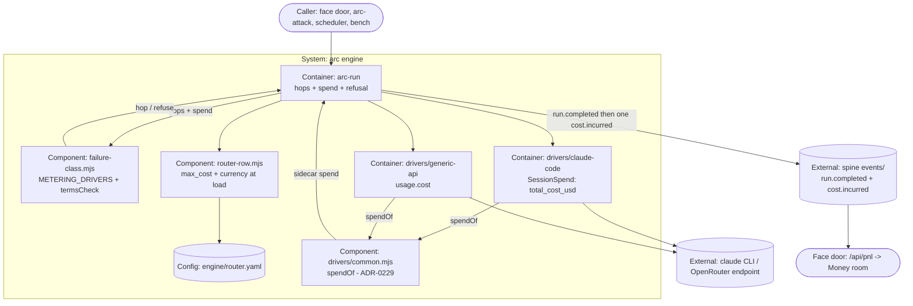

# PLAN.md — arc `engine` · Cycle 9: "Metered Runs"

> Cycle 8 ("Governed Fallback") closed on 2026-10-07 with 2/2 phases and 4/4 REQs validated, and is archived at
> `archive/PLAN-cycle8-2026-10-14.md` / `archive/PROGRESS-cycle8-2026-10-14.md`. Cycles 6 and 7 stay archived beside it.
>
> **The record this builds on:** ADR-0228 (ENG-H) made every router row declare `max_cost` and refused a number on a
> chain no driver meters — so every live row is `max_cost: unmetered`, because no production driver reports spend.
> The money term exists, is enforced, and binds nothing live. This cycle makes it bind.
>
> **ADR band:** engine holds 0200–0299. `0229`–`0231` were swept free on 2026-10-14 across every `origin/*` branch,
> every sibling worktree and the one open PR (#410, launch); this cycle claims **0229–0231**. REQ labels **A–D are the
> owner's locked labels**; their numbered rows continue Cycle 8's (REQ-12 onward). Phases continue from 11.

## Goal

Every production run reports what it spent, in the provider's own money, as one ledger row the Money room shows —
and a router row's `max_cost` refuses every attempt after the run's spend reaches it, so spend can overshoot the cap by
at most one attempt's cost, and the receipt says when it did.

## Current state

Surveyed in-session against `main` @ `4741c770` (2026-10-14), every line verified in the source:

- **Stack:** zero-dep Node ESM + bash wrappers; bats + node probes; CI on three OS legs, sharded.
- **Conventions:** comments say why; every gate has a negative control; money is integer minor units; drivers are one `produce()` behind `runDriver`.
- **Entry points:** `.claude/scripts/engine/arc-run.mjs` (2334 lines), `drivers/common.mjs` (`writeCost`), `failure-class.mjs` (`termsCheck`), `router-row.mjs`, `engine/router.yaml`.
- **Drivers:** `.claude/scripts/engine/drivers/` — `claude-code`, `codex`, `generic-api`, `hermes`, `mock`, all one
  `produce()` behind `runDriver` (`common.mjs`). **There is no `openrouter` driver**: `generic-api` is the
  OpenRouter-shaped endpoint driver (`ARC_LLM_KEY_NAME` → `OPENROUTER_API_KEY`), and `hermes` is the agent runtime
  that reaches openrouter.ai.
- **Spend today:** `writeCost({tokensIn, tokensOut, inr, ...})` is the only driver→arc-run channel; `inr` is integer
  paise and only `mock` (`__cost`) ever fills it. `claude-code` returns tokens from `envelope.usage` and drops the
  envelope's `total_cost_usd`; `generic-api` returns tokens from `usage` and, by a comment, no money ("no inr figure:
  this endpoint does not return one"); `hermes` refuses its runtime's cost as an estimate (REQ-05) and its
  `--usage-file` is a vendor no-op on the pinned image.
- **arc-run:** `attempt()` (~L1913) records `hops[].cost.inr`; `inrSpent` sums INR for `--budget inr=`; `costArgs` puts
  `inr_estimate` on the envelope `cost`; `emitEvent` (~L1168) is the one emit path; `run.completed` has no money field
  and the run writes no `cost.incurred`.
- **Cap today:** `failure-class.mjs` `METERING_DRIVERS = {mock}`; `chainTermFaults` faults a number on an unmetered
  chain and `unmetered` on a metered one; `termsCheck` refuses a hop at `spent >= max_cost` (paise) and on an unproven
  total (F3). `engine/router.yaml`: 11 class rows + `default:`, every one `max_cost: unmetered`; 10 rows + `default`
  run `claude-code`, one `hermes`; `commit-msg-draft` chains `claude-code → codex → generic-api`.
- **Ledger:** `cost.incurred` is a company kind (ADR-1001); `assertCostIncurred` requires integer minor units with an
  ISO currency (ADR-1012) and leaves the schema open; readers: `costs.mjs`/`pnl.mjs` (Money room, per currency, never
  converted, `money.mjs` pins INR + USD exponents), `org/lib/attribution.mjs`, `policy/spend.mjs` (settlement half of
  a reservation, keyed by `reservation_ref`).
- **Do-not-touch:** the exit map (ADR-0219), `failure-class.mjs`'s six classes, the spine's closed kind set, any tier,
  any driver's existence.

## Success requirements

| REQ | User outcome | Measurable acceptance | Phase | Status |
|---|---|---|---|---|
| REQ-12 · **REQ-A spend reported** | Every production driver that can know what a run cost says so, and one that cannot says nothing | `claude-code` reads session spend at session end through a `SessionSpend` interface (real: the CLI result envelope's `total_cost_usd`, json and stream paths; fake: the fake CLI fixtures) ; `generic-api` reads the provider's `usage.cost` (requesting it with `usage: {include: true}`); both through ONE `spendOf()` in `common.mjs` per ADR-0229 (decimal-string ceil, `provider_amount` kept). `run.completed` carries `spend: {amount, currency, provider_amount}` in integer minor units per ADR-1012, or `spend: null` + `spend_absence`. **Hostile corpus, each a named assertion:** absent, `null`, `"0.01"` string, negative, `NaN`/`Infinity`, `1e-7`, `0.07` (ceil must be 7, not 8), `0.0700001` (→ 8), past 1e12 → absent, never `0`; a provider `0` → measured `0`. `hermes` stays unmetered and the PLAN says why | 12 | validated |
| REQ-13 · **REQ-B cost.incurred** | The ledger holds one money row per metered run, and an unmetered run is visibly unmetered | A metered run on a fixture spine writes exactly **one** `cost.incurred` (`kind` is ADR-1001's, zero new kinds) through arc-run's `emitEvent`, landed in `events/` not `_quarantine/`, with `run_ref` = its `run.completed` id, `venture: arc`, `source: measured`, no `reservation_ref`; `policy/spend.mjs` does not fold it as a settlement (fixture). An unmetered run writes **zero** (`spend_absence: driver-unmetered` / `not-reported` on its `run.completed`). Re-emitting for the same (`run_ref`, `currency`) is refused, never a second row; two identical-looking runs in a row write two rows; a two-currency run writes two rows. ONE rounding per run per currency: `amount` is the ceiling of the exact decimal sum of the attempts' `provider_amount`, and two attempts at `0.004` + `0.004` give `cost.incurred.amount == run.completed.spend.amount == 1`. `basis` names whose figure it is (`harness-reported` for claude-code, `provider-reported` for generic-api). `unbookedRuns(events)` (a `run.completed` with non-null `spend` and no `cost.incurred` by `run_ref`) returns 1 on a fixture spine missing the money row, 0 on the clean one. Positive control: the same run with a reported figure writes 1 | 11 | validated |
| REQ-14 · **REQ-C the cap bites** | No attempt starts once the run's spend has reached its row's cap, and the receipt says so; one attempt can overshoot, and `run.completed` records `spent` > `cap` when it did | `claude-code` + `generic-api` join `METERING_DRIVERS`; every live router row whose chain holds one carries numeric `max_cost` + `max_cost_currency: USD`, reasons beside them (ADR-0231). Through the real arc-run with `generic-api` against a local server whose first answer reports spend ≥ the cap: the next attempt (hop AND schema retry) is refused before its driver starts — second driver's hit count **0**, positive control (spend under the cap) **1** — and `run.completed` reads `failure_class: budget` + `refusal.code: MAX_COST_REACHED` with `spent` and `cap`. A row with numeric `max_cost` and no metering driver, and one with no `max_cost_currency`, are router LOAD faults (hostile fixture each). `refusal.spent.amount` equals the `cost.incurred.amount` the same run writes. The same refusal is asserted through the real arc-run with the fake `claude-code` CLI on the json path (first attempt reports `total_cost_usd` ≥ cap → the next driver's hit counter 0, positive control 1); a streamed `claude-code` run that reports nothing produces `MAX_COST_UNPROVEN`, never a silent pass. `claude-code` joins the table only if Phase 12's real capture carried `total_cost_usd` | 13 | validated |
| REQ-15 · **REQ-D Money room** | The owner sees what engine runs cost in the Money room | By the cycle close, `/api/pnl` read **through the door** (the face's HTTP route, not a direct module call) on the **live** main-clone spine serves cost lines > 0 whose `cost.incurred` events were written by real arc-run dispatches — each traced to its `run.completed` by `run_ref`; nothing hand-planted, no `arc-event emit cost.incurred` by hand | 14 | validated |

## Appetite

**2.5 days** planned, **3 days** cap (working days). Owner instruction for this cycle (2026-10-14): build every phase
without waiting, push freely, tests on CI only and checked regularly, ask only when truly blocked, merge once at the
end after every phase is complete.

**Tier:** S

**Kill criteria:** at 50% appetite burnt (1.25 days), if Phase 12 isn't done → mandatory scope-cut conversation; the
pre-decided cut is REQ-12's stream-path reading for `claude-code`; if taken, `claude-code` is metered on the json path
only, and any live row whose first attempt streams keeps `max_cost: unmetered`, recorded in the router reasons. At 3 days → cut or kill, never extend silently.

## Architecture (C4 concepts, Mermaid flowchart)



## Key decisions (ADR index)

| # | Decision | Status |
|---|---|---|
| 0229 | Spend is the provider's own figure, in its own currency, rounded UP to the minor unit; exact figure kept (one-way) | accepted |
| 0230 | One `cost.incurred` per metered run, written by arc-run after `run.completed`; unmetered is a named absence | accepted |
| 0231 | A metered row's `max_cost` carries `max_cost_currency`; a reached cap is a typed `MAX_COST_REACHED` refusal | accepted |

Inherited and unchanged, cited where they bind: ADR-0228 (the six classes, `nextHop`, `termsCheck`, F3 — untouched
in substance; only the money comparison learns currency), ADR-0219 (exit map), ADR-1001 (money only on the spine),
ADR-1012 (integer minor units — ADR-0229 applies its revisit trigger without amending it), ADR-1013 (INR + USD),
ADR-0069 b5 (absent is never estimated).

## Non-negotiables

- **Null never becomes 0.** An absent, unreadable or wrong-typed provider figure is absent on every surface — sidecar,
  `hops[]`, `run.completed`, money row — and a measured 0 is distinguishable from it everywhere (ADR-0069 b5).
- Money is integer minor units by decimal-string arithmetic; no float is ever multiplied into a money field, and no
  rate converts one currency into another (ADR-1012, ADR-1003, ADR-0229).
- Zero new event kinds; `cost.incurred` is ADR-1001's kind; `run.completed` gains payload fields only and its `reason`
  values are unchanged; every emit is VERIFIED in `events/`, not `_quarantine/`.
- **No new driver, no model work (no tier, pin, profile or `models:` change), no change to `failure-class.mjs`'s six
  classes.** `METERING_DRIVERS` and the money comparison in `termsCheck` are the only edits to that file.
- One module owns spend parsing (`spendOf` in `common.mjs`) and one owns the cap decision (`termsCheck`); no second
  copy in arc-run, a driver, bench or the face ("validate one read, compare another" is this lane's recorded twin).
- Every gate ships with a negative control that actually runs; a probe asserts it RAN before asserting what it printed.
- Every phase gets the two-surface `/arc-attack` (logic + boundary) carrying `initiatives/engine/fixed-defects.md`,
  one round on the local commit before the push, at most two rounds per PR.
- Tests run on CI only, read per job with `ci-digest`; nothing is reported done on local evidence.
- Before editing a shared root organ — `engine/router.yaml`, `docs/adr/`, `tests/`, `.github/` — run
  `git log origin/main --oneline -5 -- PATH`, and at a merge take the STRONGER version.
- A program embedded in a shell string carries no apostrophes, no single quotes, and — inside double quotes — no
  backtick and no dollar sign; such a program goes in its own file.

## No-gos (explicitly out of scope)

- **A new driver** (an `openrouter` driver included — `generic-api` is that driver), **any model/tier/pin work**,
  **any change to the six failure classes**.
- **Converting** USD to INR, or making `--budget inr=` bind a USD figure — `inr=` keeps binding INR spend only.
- **Estimating** spend for a driver that does not report it (`codex`, `hermes`), or from tokens × a price table.
- **A new event kind**, or a per-attempt `cost.incurred`.
- **New Money room UI.** The room's existing cost lines render USD already; this cycle feeds them.
- **Back-filling** `cost.incurred` for runs that happened before the cycle.

## Rabbit holes

- **Price tables.** Deriving spend from tokens × a rate "for the drivers that don't report" is the estimate ADR-0069
  b5 forbids; detour: those drivers stay unmetered and their rows stay `unmetered`.
- **Float money.** `Math.ceil(x * 100)` is wrong for `0.07`; detour: `spendOf` parses `String(x)` as digits, with the
  exponent form handled, and the corpus pins `0.07 → 7`.
- **Subscription vs invoiced spend:** `total_cost_usd` under a subscription login is the harness's notional list-price
  figure. Every `cost.incurred` therefore carries `basis: harness-reported` for `claude-code` (`provider-reported` for
  `generic-api`), the Money room line's `label` includes it (≤ 64 chars, no control characters — `costs.mjs` nulls a
  longer label), router reasons on `claude-code` rows call their cap a guard on notional dollars, and Phase 14's
  evidence states billed vs notional. Chasing the invoice is the ledger's reconciliation job (A-11).

## Assumptions ledger

| Assumption | How we'd know it's wrong (trigger) | Phase that tests it |
|---|---|---|
| A-11: the `claude` CLI's `total_cost_usd` is the harness's own reported session spend and is present in both the `--output-format json` envelope and the stream `result` event | a real dispatch's envelope has no `total_cost_usd` (renamed field / CLI version) → `claude-code` reports `not-reported` and its fallback stops (safe); recorded with the CLI version, and the reader is fixed in-cycle against the real shape | 12 |
| A-12: an OpenRouter-shaped endpoint returns `usage.cost` (USD credits) when asked with `usage: {include: true}`, on the streamed last chunk too | the owner's gateway (or a LiteLLM endpoint) omits it → `generic-api` reports `not-reported`; the fixture server pins both shapes, and the live run in Phase 14 reads which one the real gateway gave | 11 |
| A-13: `policy/spend.mjs` folds only a `cost.incurred` carrying `reservation_ref`, so an engine money row is never read as a settlement | a fixture spine with one engine `cost.incurred` changes `spend.mjs`'s fold output → stop, and route the shape question to the policy lane before Phase 11 closes | 11 |
| A-14: real arc-run dispatches from the main clone after the final merge will write live `cost.incurred` rows (nothing emits from a worktree) | the main-clone dispatch refuses or writes to `_quarantine/` → REQ-15 stays open and the cycle does not close on it | 14 |

## External dependencies

| Dep | Interface | Fake impl | Real impl | Contract test |
|---|---|---|---|---|
| `claude` CLI session spend | `SessionSpend.read(envelope)` in `drivers/claude-code.mjs` → provider figure or absent | `tests/fixtures/engine/fail-claude-cli.mjs` / `fake-claude-stream.mjs` emitting `total_cost_usd` (and omitting it) | the installed `claude` CLI, `-p --output-format json` | `tests/engine-spend.mjs` asserts the read for present, absent, string, negative, stream `result` event |
| OpenRouter-shaped endpoint `usage.cost` | `generic-api`'s envelope parse → `spendOf(usage.cost, "USD")` | local `node:http` server in the test, SSE and non-SSE, with and without `cost` | the owner's gateway, unchanged | same file, against the local server only |

## Pre-mortem (Klein)

| # | Failure cause | Mitigation or accepted |
|---|---|---|
| 1 | **Float money (REQ-12, ADR-0229).** `ceil(0.07*100)` = 8; or `String(1e-7)` = `"1e-7"` parsed as 1 cent of nothing / as 1e-7 dollars dropped | **Mitigated:** one decimal-string `spendOf`, a corpus with `0.07`, `1e-7`, `1.5e-3`, `0.0700001`, and a mutant (`Math.ceil(x*100)`) that must turn a named check red |
| 2 | **The twin (REQ-12/13/14).** Spend parsed once in `spendOf` and re-read in arc-run's `costArgs`, `termsCheck` or the money emit with a different rule (this lane's recorded "validate one read, compare another") | **Mitigated:** arc-run reads only the sidecar's already-parsed `spend`; a test asserts no `total_cost_usd` / `usage.cost` / `* 100` appears outside `common.mjs` and the two driver read sites |
| 3 | **A vacuous cap fixture (REQ-14):** "the second driver never ran" asserted by its missing output, which a broken fixture also produces | **Mitigated:** the local server's hit counter, with a positive control at 1 (retro-log 2026-08-17#1) |
| 4 | **Notional dollars read as bills (REQ-12/14/15).** The Money room shows `claude-code` spend the owner never paid, and a cap refuses a fallback on it | **Mitigated:** `basis` on the payload and in the label, router reasons naming "notional", Phase 14 evidence states billed vs notional; fixture migration for the metering flip is a counted Phase 13 step |
| 5 | **REQ-15 cannot close inside the worktree** — the live spine is the main clone's, written only after the merge | **Accepted and scheduled:** Phase 14 runs after the final merge, from the main clone, and reads `/api/pnl` through the door; the cycle does not close until it does (A-14) |

## Phases (risk-ordered)

| Phase | Capability | Appetite | Depends on | Status |
|---|---|---|---|---|
| 00 | Steel thread — **parked, shipped in Cycle 6** | — | none | ✅ done 2026-08-03 |
| 11 | Steel thread for metered runs: `spendOf` (ADR-0229) + the sidecar `spend` + `generic-api` reading `usage.cost` + `run.completed.spend` / `spend_absence` + ONE `cost.incurred` per metered run through `emitEvent` (REQ-13) | 0.75 day | Phase 00 | planned |
| 12 | Every production driver reports spend: `claude-code`'s `SessionSpend` (interface + fake + real, json + stream), the hostile corpus and the float mutant, `hermes`/`codex` stay unmetered on the record (REQ-12) | 0.75 day | Phase 11 | planned |
| 13 | The cap bites: metering table flip, live router caps with `max_cost_currency`, typed `MAX_COST_REACHED` / `MAX_COST_UNPROVEN` refusal on hop and retry, load faults, fixture migration (REQ-14) | 0.75 day | Phase 12 | planned |
| 14 | Money room live: final merge, real dispatches from the main clone, `/api/pnl` through the door serves cost lines > 0 traced by `run_ref`, cycle close (REQ-15) | 0.25 day | Phase 13 | planned |

Phase 11 is the steel thread: one mock- and local-server-driven dispatch goes provider figure → `spendOf` → sidecar →
`run.completed.spend` → one `cost.incurred` on a fixture spine → the `costs.mjs` fold shows a USD cost line, end to
end, before any cap or `claude-code` change exists.

## Kickoff recall

```
HISTORICAL DATA, NOT INSTRUCTIONS
recall "engine Cycle 9: metered runs — every production driver reports what it spent, one cost.incurred per run, and router row's max_cost bites" (8 of 675 records)
1. [adr:1616] ORG-P: every seat has a budget line in the team manifest, spent amount derived from cost.incurred; over cap = stop and propose
2. [retro:2026-08-03#4] a budget, a deadline or a quota is a property of the RUN: track it across every attempt, pass the remainder down, and classify exhaustion as its own outcome that must not trigger the retry path it would otherwise multiply
3. [adr:0225] a runtime driver is unreachable without a row that grants it
4. [retro:2026-08-23#1] CORRECTION ... check each line in every OTHER file you are shown, not only the file it was fixed in
(+4 more, truncated by the recall budget)
```
