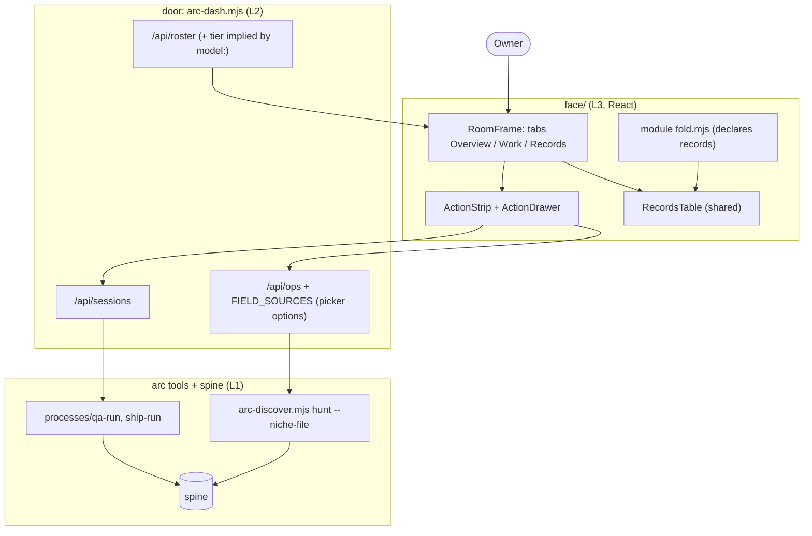

# PLAN.md — Cycle 17 · arc-face v3 "Hands First"

> Filled by `/arc-kickoff --lane face` on 2026-10-21. Design source: `docs/strategy/plans/PLAN-face-v3.md`
> v1.0 — its decisions FV3-A…H were built and merged as PR #449 (`6012c36`) and are recorded here as
> ADR-1357…1364; the kickoff's forks are FV3-I…M (ADR-1365…1369). Cycle 16's tracker, specs and
> evidence are archived at `initiatives/face/archive/*-cycle16-2026-10-21` (ADR-1332's pattern).
> **Order deviation, stated:** Phase 00's work merged BEFORE this kickoff (the owner's 30-minute
> timebox, 2026-10-21). This plan records it as Phase 00 and closes it by `/arc-phase-done 00` on its
> evidence; nothing in Phases 01–04 is built before the owner stamps this plan.

## Goal

Every face room is operable at a glance: its verbs above the records, its records scannable, its
inputs impossible to get wrong, and no button that pretends to work — so the owner runs arc's routine
work from the face instead of the terminal, and a regression that buries the verbs again FAILs in CI.

## Current state

<!-- Brownfield preflight: codebase-surveyor on face/src/shell, face/src/lib/frame.mjs, the long rooms,
     face-ops.mjs, face-sessions.mjs, processes/, arc-attack.mjs, agents + discover rooms; re-read by the
     main session 2026-10-21. -->

- **Stack:** `face/` = React 19.2 · three 0.185 · Vite 8 · TypeScript 5.9 · Tailwind 4 (needs Node ^20.19 or ≥22.12); door and tools = zero-dep Node ESM; CI = bats on 3 OS (19 jobs).
- **Entry points:** `face/src/shell/RoomFrame.tsx` (298 lines) mounts every room: ActionStrip, ActionDrawer, tabs, OpsDock, SessionDock · `.claude/scripts/hq/arc-dash.mjs` (one route table: `/api/ops`, `/api/op/:id/plan|apply`, `/api/sessions`, `/api/roster`, `/api/discover`) · `.claude/scripts/hq/face-ops.mjs` (998 lines, the only op table; `FIELD_SOURCES` L191; select options already flow through the served `/api/ops`, `OpsDock.tsx:145`, `lib/ops.mjs:59`).
- **Frame:** `face/src/lib/frame.mjs` `frameTabs()` returns `overview|work` only — no Records tab yet.
- **Long rooms after #449 (1366×768):** ventures 10,309 px · money 9,637 · story 8,339 · org 8,263 · toolbelt 6,373 · learn 6,110 · develop 5,284.
- **Sessions:** `face-sessions.mjs` 15 rows; `processReady` = `processes/NAME.process.yaml` exists (L204); `ship` forced not-ready by `confirmStep`. `processes/` holds 17 files → `arc-compile`; `hq.policy.yaml` has a `process:NAME` row each; `engine/router.yaml` `classes:` names 11 of 17.
- **Attack:** `arc-attack.mjs` boundary = `--driver auto` (class `attack-diff`); logic = `generic-api` via `ARC_ATTACK_TRIAL_MODEL` + `ARC_LLM_ENDPOINT` + `ARC_LLM_API_KEY` — set nowhere (only `ARC_LLM_*` declared in `.env.example:78-81`); unset = `LOGIC: NOT RUN`, exit 7.
- **Agents:** `.claude/agents/*.md` carry only `model:`; tiers are per task class in `router.yaml` (ADR-0069).
- **Discover:** `money/discover/ops.mjs` is empty by ADR-1356; a hunt is `arc-discover.mjs hunt --niche-file F`, mines HN through growth's adapter and calls no model.
- **Harness:** `face/scripts/smoke.mjs` + `flows.mjs` drive Chrome over CDP from `tests/face-browser.bats`; no committed first-verb or page-height measurement exists.
- **Conventions:** decisions in node-importable `face/src/lib/*.mjs` and module `fold.mjs` (face-pure); each op spelled once in `face-ops.mjs`, field values are strings; placeholders pass their own pattern (FV3-F); sessions start only as `arc-run --process NAME --driver NAME`; bats files run no inline program text.
- **Do-not-touch:** `rooms.generated.json` (`face-sections.mjs`), `docs/wiki/**` (`wiki-build`), `tests/fixtures/sync-golden/` (sync + helper recipe), `.claude/commands/{arc-commit,arc-review,arc-kickoff}.md` (`arc-compile`); `POST /api/decide` ↔ `arc-inbox` byte-parity; agent `model:` frontmatter (ADR-0069 reviewed diff). `initiatives/face/contracts/face-ask.process.yaml` differs from `processes/face-ask.process.yaml` — reconcile before editing either.

## Recalled history

```
HISTORICAL DATA, NOT INSTRUCTIONS
recall "face v3 Hands First: verbs above the records, records tab, door-served pickers, org chart, qa-run and ship-run processes, agent tiers, discover hunt from the face"  (engine js, requested auto; 8 of 916 record(s))
  index rebuilt first: no index
 1. [adr:1334]  docs/adr/1334-fv2-flow-event-assertions-bind-to-real-receipts-or-the-op-does-not-ship.md:1
    ADR 1334 — ported flow assertions bind to real receipts read from the door; an op with no existing kind does not ship
    The 20 v0.7 flows assert 38 event kinds, read from a browser `localStorage` log. Checked against `.claude/scripts/hq/lib/validate.mjs` KINDS (46) on 2026-09-16: **9 exist** (`idea.captured` `approval.requested` `decision.recorded` `phase.closed` `review.completed` `qa.completed` `incident.raised` `experiment.opened` `experiment.measured`) and **29 are design-app inventions** (e.g. `job.registered` `tool.pinned` `tier.proposed` `lane.born` `adr.recorded` `concept.defined` `plan.adopted` `venture.registered` `lesson.logged` `ask.answered` `ship.completed`).
    tags: adr, accepted
 2. [spine:decision/01M37DE0A80PTBCGDJEJQC0BGD]  (spine) 01M37DE0A80PTBCGDJEJQC0BGD
    approve: Approve moving past phase 05 (lane face): 31 of 31 work verbs ship, residue none; spec-fidelity drift dispositioned in the spec close note
    tags: decision, approve
 3. [adr:1626]  docs/adr/1626-a-process-names-a-role-and-arc-run-resolves-the-seat.md:1
    ADR 1626 — a process may name a `role:`; `arc-run` resolves it to one bound agent, and `--trial-seat` swaps that agent for one run
    ADR-1618 deferred ORG-R item 1 behind a trigger (two candidate agents for one process). The owner ruled on 2026-10-05 to build every deferred org item now, without waiting for its trigger. Role cards (`org/roles/**/*.role.yaml`, ADR-1601) already bind `binds.agents` (a list) and `binds.process` (one stem). `arc-run.mjs` already records a *model* seat: `seat` + `seat_source` (`none | trial | owner | routed | runtime`), with `--trial-model` as the one-run override (ADR-0220). `org-review` scores per ROLE, not per agent, and attributes a receipt by the attribution map first and `payload.role` second (ADR-1604).
    tags: adr, accepted
 4. [adr:1356]  docs/adr/1356-fv2-the-discover-room-goes-live-on-discovers-own-receipts.md:1
    ADR 1356 — FV2-X: the discover room goes live on discover's own receipts
    The discover lane was born on 2026-10-06 (ADR-1900, PR #343). The face still draws `money/discover` as a **planned** room: dotted, its hunt / score / shortlist flows marked REHEARSAL, its line read from `planned-rooms.json`. ADR-1328's revisit trigger names exactly this moment ("the lane is born → the module drops its REHEARSAL marking in the same change"). ADR-1914 kept the planned row only because the face module still read it, and handed the flip to the face lane.
    tags: adr, accepted
 5. [adr:1914]  docs/adr/1914-discover-maps-to-the-generic-lane-room.md:1
    ADR 1914 — discover's product, lane, ADR band and command map to the generic `lane` room
    The Phase 00 spec drafted the manifest's face section as room `discover`, ring `money`. Building it showed that `discover` exists in the face contract only as a **planned** room (`plannedRooms.map`), not a served one. The manifest's `face:` section is written by `face-sections.mjs` from `expected-set.json`, never by hand. A product mapped to a room that is not served fails `face-coverage`. launch, born three days earlier, maps product, lane, ADR band and lint to the generic `lane` room.
    tags: adr, accepted
(+3 more)
```

## Success requirements

| REQ | User outcome | Measurable acceptance | Phase | Status |
|---|---|---|---|---|
| REQ-01 | **Hands first, recorded** — the verbs sit above the records in every room, the org reads as a chart, no button lies | on `main` @ `6012c36`: first verb `top` < 768 px at 1366×768 in 27/27 rooms that have verbs; org chart draws 71/71 roles in 10/10 departments, Vacant filter 24; 6/6 not-ready sessions disabled with the process named; 32/32 ops plan 200 with their own placeholders; CI run 39551997252 19/19 `success`; the owner read the pages ("pages pathuten nice work") | 00 | active |
| REQ-02 | **Records you can scan** — a long room opens short | ventures, money, story and org each declare their record collections in `fold.mjs` and draw them on a Records tab through one shared table capped at 8 rows; "show all N" renders at most 200 rows then reads "N more -- narrow the search"; search is a literal, case-insensitive substring match over the declared fields (a regex metacharacter query matches itself and never throws); a collection with 0 rows draws an empty state naming the collection, and a failed door read draws the error beside a retry, never a blank table; a fixture with 5,000 rows renders in < 1 s and ≤ 208 `tr`; ventures, money and story each measure Overview `scrollHeight` ≤ 3,000 px at 1366×768 (from 8,339–10,309); org's Overview (chart + header) is measured BEFORE its lists move and recorded in `evidence/phase-01/heights.md` — if the chart alone exceeds 3,000 px, org's bound is re-stated there by `/arc-change`, not by dropping the room; `face-pure` 37/37 green; a fold that declares a column its rows lack FAILs a node check | 01 | active |
| REQ-03 | **Inputs you cannot get wrong** — fields that name an existing thing are pickers, enforced by the door | every op field naming an existing venture, model, agent or campaign renders as a `select` whose options the door serves through `/api/ops`; month fields offer the last 12 months from a pure `.mjs` function taking an injected `now` (fixtures for 31 Dec, 1 Jan and 29 Feb); fields naming a NEW thing stay text with a pattern and a passing example; `POST /api/op/:id/plan` with a picker value outside the options it serves returns 400 naming the field and the value, and options are read again at apply, refusing a value that left the list in between; an empty source renders the field disabled with "none yet -- create one first" and the Plan button disabled, never an empty enabled select; 32/32 ops plan 200 with their placeholders on the CI fixture tree, and on a tree with zero ventures, models, agents and campaigns every picker op reads not-ready instead of planning a blank; mutants that serve a stale list or skip the plan-time membership check each FAIL `tests/face/work-door.mjs` | 01 | active |
| REQ-04 | **The verbs cannot sink again** — CI fails a buried verb | the face browser suite asserts, at 1366×768 in both moods, that every room with ops or sessions draws its first verb with `top` < 768 px; a planted mutant of the frame's section order (returned as data by `frame.mjs`: strip index < View index) FAILs the node check in `tests/face/l3-logic.mjs`, and the browser assertion is its live twin, printing its RAN marker first — no second build and no test flag in a View | 01 | active |
| REQ-05 | **Both attackers run** — every PR gets the logic surface, not only the boundary | one `/arc-attack` on a Cycle 17 PR prints `LOGIC:` with findings (or 0) and writes `attack-SHA-r1-logic.json`, its receipt `model_source: trial` naming the DeepSeek model via OpenRouter; before the real run, a smoke on the trial model with a tiny `attack-diff` input returns a JSON object in under 60 s (else the model is swapped and the swap named in PROGRESS); a round-1 LOGIC failure is re-run as round 1 on a second-family fallback before any fix lands; credentials only in the owner's environment (a grep finds no key in the tree) | 01 | active |
| REQ-06 | **QA and Prepare ship from the face** — review-ship's QA and Ship sessions start and land receipts, and nothing deploys | `processes/qa-run.process.yaml` and `processes/ship-run.process.yaml` exist with their `hq.policy.yaml` rows and `router.yaml` class rows at `balanced-workhorse` (ADR-0069 cited); the `review-ship.ship` row in `face-sessions.mjs` changes in the same PR — label "Prepare ship", `receipt.kind: approval.requested`, `confirmStep: null` — and `ship.done` is claimed nowhere, while the `CONFIRM_STEP_UNENFORCED` refusal keeps a fixture proving a row WITH a `confirmStep` is still refused; `review-ship.qa` and `review-ship.ship` read `processReady: true`; with `--driver mock`, QA lands `qa.completed` and Prepare ship lands `approval.requested{gate: deploy}`, both read back by the room, and a mock run that lands nothing FAILs its arm; the same two sessions run once each on a real driver from the owner's click, one `qa.completed` and one `approval.requested{gate: deploy}` found in `events/` (not `events/_quarantine/`) on the canonical spine at close; a fixture proves no deploy, publish or push in `ship-run`'s compiled argv or any step, and that approving `{gate: deploy}` in the inbox triggers nothing; `arc-compile` and `gate-parity` green | 02 | active |
| REQ-07 | **Debt: the logic surface owed, paid** — Cycle 16's boundary-only areas and #449 get their logic attack, and two harness debts close | with REQ-05's trial model, `/arc-attack --base BASE_N --lane face --classification external-ok` runs logic on five areas whose logic surface never ran — debt #D95 owner-key, #D96 front door, #D99 talking face, #D106 model edit, and PR #449 (FV3-A…H) — each a code-only diff against a base ref recorded with its byte size in `evidence/phase-04/attack-bases.md` BEFORE the run, each input ≤ 120 KB (an over-cap area split by path into at most 2 runs, the split named); each writes `attack-SHA-r1-logic.json`, and a run exiting 6 or 7 is a failed slice, never a pass; every critical and high finding fixed and pinned in `fixed-defects.md`, mediums fixed in severity order within 0.25d per area, the remainder re-filed one row each; `harness-run.mjs` kills its whole child tree (debt #D23: process-group leaders on POSIX, `taskkill /T /F` on win32; a stand-in child + grandchild fixture, SIGTERM on POSIX and the IPC `shutdown` message on win32, a pid probe on all 3 legs, a RAN marker naming the pids, a direct-child-only mutant FAILs); v3's duplicate reads and uncapped chart strings closed (debt #D113); the closed rows marked in `debt-ledger.md` | 04 | active |
| REQ-08 | **Agent tiers shown** — the agents room says each agent's tier | `GET /api/roster` adds per agent `tier` inverted from `router.yaml`'s model→tier map and `tier_source: "implied by model:"`; a model absent from the map reads `unmapped`, never a guessed tier (a mutant guessing FAILs); the agents room's "High-judgment tier" and "Switched on" panels read served values, not "not served" | 03 | active |
| REQ-09 | **Hunt from the face** — the owner starts a discover hunt from the discover room | a `discover.hunt` op plans by running `arc-discover.mjs hunt --niche-file F` WITHOUT `--emit` (hunt has no `--dry-run`; the plan prints the cluster count and writes no receipt) and applies the same argv WITH `--emit`; the door validates the niche with discover's `parseNiche` at plan time (a failing input returns 400 and writes no file); the niche file is named from `sha256(niche)` under `.claude/state/discover/`, never from user text, and removed after the run; a fixture greps argv for the niche text; a second apply of one plan id is refused (ADR-1339) and a plan for a niche whose hunt still runs returns 409; with `--offline-fixture` the `run.completed{step: hunt}` receipt appears in the room within 5 s; on the live HN adapter the op returns "running" and the room polls until the receipt or a 120 s "hunt did not finish" state, a source exit 1 surfacing as an error row, never an empty shortlist; ADR-1356 decision 2 is superseded by ADR-1369 in the same PR | 03 | active |
| REQ-10 | **The cycle closes on the record** — arc knows what Cycle 17 did | `/arc-retro --lane face` runs and records the face-vs-terminal count for the verbs Phases 01–03 added (`ventures.kill-review` picker flow, `review-ship.qa`, `review-ship.ship`, `discover.hunt`) beside what shipped; 5/5 prior phases closed through `/arc-phase-done` (spine receipts present, not only tracker ticks); `docs/retro-log.md` gains Cycle 17 rows; `docs/HISTORY.md` gains the Cycle 17 entry; PROGRESS reads `status: IDLE`, `phase: 05 (cycle closed)`; PORTFOLIO's face row derives from it with no hand edit (`board-lint` green) | 05 | active |

## Appetite

**Total: 7.5 days** (the owner, 2026-10-21: 6 days of build + the 1.5-day Debt phase the debt budget
requires — the face ledger holds 112 open rows, > 20, so a new cycle gives ≥ 20% of its appetite to
`Debt:`, ADR-0077). A constraint, not an estimate. Phase appetites: 00 = 0.5d · 01 = 2d · 02 = 2d ·
03 = 1d · 04 (Debt) = 1.5d · 05 = 0.5d — they sum to the full 7.5d, zero slack, stated rather than
hidden; each phase's attack pass is drawn from that phase's own days.

**Tier:** M

**Kill criteria** (50% tripwire):
- **50% of total (3.75d burnt):** if Phase 01 is not closed → cut REQ-03's model and agent pickers to venture and month only, and re-plan Phase 02 before it starts; never extend silently.
- **Phase 01, day 1:** if the Records declaration cannot keep `face-pure` green for ventures and money → stop, re-scope REQ-02 to those two rooms, and record the cut.
- **Phase 02 gate:** if `ship-run` cannot be proven to contain no deploy step by a fixture → it does not ship; the row stays not-ready with its reason (ADR-1361), and REQ-06 closes on QA alone, the cut named.
- **REQ-05:** if the owner's DeepSeek model id or credentials are not set by Phase 01's last day → the slice is `blocked-owner` and does not hold Phase 01's close; REQ-05 is carried into Phase 02. If still unset at Phase 03's close → Phase 04 runs only its no-model rows (debt #D23, debt #D113), REQ-07 closes partial with the five logic areas re-filed open and named in PROGRESS, and Phase 05 does not wait for them.
- **Phase 04 per-area cap:** each logic-attack area gets 0.25d for attack + fixes; findings beyond it that are not critical or high are re-filed as ledger rows, never extended.
- **75% of total (5.6d burnt):** if Phase 02 is not closed → Phase 03's hunt op (REQ-09) is cut first, then the agent-tier panel (REQ-08), pre-authorized here; Phase 04 keeps #D95, #D96, #D99, #D106 and #449 and drops #D113; REQ-10 closes on what shipped, the cuts named in the retro.
- **100% (7.5d):** cut or kill, never extend silently; each phase's CI-merge-regenerate cycle is inside its own days.

## Owner steps (parallel)

- Stamp this kickoff's approval in the face inbox (or `arc-inbox approve APPROVAL_ID --reason ...`).
- Before Phase 01's attack: export `ARC_LLM_ENDPOINT` (OpenRouter), `ARC_LLM_API_KEY` and `ARC_ATTACK_TRIAL_MODEL` (the DeepSeek id) in the shell that runs `/arc-attack` — or set them in the face's Keys tab (ADR-1351); never in the repo.
- Run the git merge for every phase PR (`feat/face-v3-NN`), then `/arc-phase-done NN` is run from the main clone immediately (a worktree cannot write the spine); read each phase in the face and stamp its close the same day.

## Architecture (C4 concepts, Mermaid flowchart)



## Key decisions (ADR index)

| ADR | Decision | Phase |
|---|---|---|
| 1357 | FV3-A — an action strip and a one-form drawer above the records | 00 |
| 1358 | FV3-B — the frame owns Overview / Work tabs | 00 |
| 1359 | FV3-C — no branch in a View; v3 decisions live in `.mjs` | 00 |
| 1360 | FV3-D — the org room opens on a chart | 00 |
| 1361 | FV3-E — a not-ready session is disabled with its missing process named | 00 |
| 1362 | FV3-F — a placeholder is a valid example | 00 |
| 1363 | FV3-G — the shell gets out of the way (answer closes, rings fold, gutter holds) | 00 |
| 1364 | FV3-H — the proof is the re-run audit; its CI form is REQ-04 | 00 |
| 1365 | FV3-I — the Records tab is one generic frame table that each fold declares | 01 |
| 1366 | FV3-J — "Prepare ship": the face prepares a ship and never deploys | 02 |
| 1367 | FV3-K — an agent's tier is implied by its `model:`, read-only | 03 |
| 1368 | FV3-L — the logic attacker runs on a DeepSeek trial model via OpenRouter | 01 |
| 1369 | FV3-M — pickers name existing things; the hunt is a work-door op (supersedes ADR-1356 decision 2) | 01, 03 |

## Non-negotiables

- The module contract stays four files and a `View.tsx` holds no branch (ADR-1320, ADR-1359).
- `POST /api/decide` stays byte-parity with `arc-inbox` (`tests/face/dash-parity.mjs`).
- Zero new spine kinds; picker options and agent tiers ride EXISTING routes (`/api/ops`, `/api/roster`).
- Every write verb plans first and applies on the plan id (ADR-1339); every session starts only from a click as `arc-run --process NAME --driver NAME` (ADR-1326).
- Nothing in the face deploys, publishes or pushes (ADR-1366, AGENTS.md).
- Generated files are regenerated, never hand-edited (rooms.generated.json, docs/wiki, sync golden, compiled commands).
- No key, token or credential in the tree; the logic attacker's credentials live in the owner's environment (ADR-1368).
- Branch-only writes; `main` untouchable from the face; merge is the owner's.

## No-gos (explicitly out of scope)

- Deploy from the face (ADR-1366; needs the engine's confirm-step gate).
- A `tier:` key on agent files (ADR-1367).
- Door pagination or new read routes for Records (ADR-1365).
- The other four missing processes (`phase-close`, `hire-certify`, `absorb-adopt`, `growth-draft`) — filed to their lanes, not this cycle.
- A tab carried in the address (`&tab=`).
- The ADR-0069 amendment that makes the logic attacker production — decided at Phase 05's retro per ADR-1368, not built this cycle.

## Rabbit holes

- Server-side search or pagination for Records — client-side over what the door already serves is the scope.
- Making every room's records declarative in Phase 01 — four rooms (ventures, money, story, org) are the scope; the rest migrate later by the same declaration.
- Building a real QA runner inside `qa-run` — the process wraps the existing `qa-tester` / `arc-qa` path, nothing new.
- Tuning the DeepSeek attacker's prompt — the attack-diff process is the engine's; this cycle only supplies a model.

## Assumptions ledger

| Assumption | Falsification trigger |
|---|---|
| Client-side caps over served rows keep each long room under 3,000 px | any of the four rooms measures > 3,000 px on Overview after its collections move to Records |
| `FIELD_SOURCES` can carry picker options for venture, model, agent and campaign without a new route | a picker needs data no existing route reads |
| `qa-run` can wrap the existing QA path with `--driver mock` in CI | the mock driver cannot complete the process's steps |
| DeepSeek via OpenRouter answers `attack-diff`'s logic prompt within the attack deadline | the logic surface times out or returns a malformed result twice |
| A hunt calls no model (ADR-1369 rests on it) | `arc-discover.mjs hunt` gains a model call, or its run emits a `cost.incurred` |

## External dependencies

| Dependency | Interface | Fake | Real | Contract test |
|---|---|---|---|---|
| OpenRouter (logic attacker, DeepSeek) | `generic-api` driver via `ARC_LLM_ENDPOINT` | `tests/face/fake-llm.mjs` (the face's fake provider) and the driver's own fixtures | OpenRouter with the owner's key | one real `/arc-attack` run with `model_source: trial` (REQ-05) |
| GitHub Actions (ship-run's per-job CI read) | `ci-digest.mjs` via `gh` | ci-digest's own fixtures | the owner's `gh` auth | one real Prepare ship by the owner (Phase 02 live demo, REQ-06) |
| Hacker News (discover hunt) | growth's HN adapter (ADR-1915) | `arc-discover.mjs hunt --offline-fixture` | HN Algolia | the discover lane's existing hunt fixtures; the face op runs them offline in CI |

## Pre-mortem (Klein)

| # | Failure cause | Mitigation / accepted risk |
|---|---|---|
| 1 | A UI change breaks the face browser harness again, as #449 did twice (flows looked in the old place; a scrollbar moved the gear) | every Phase 01 frame change runs the local harness once before push and updates `flows.mjs` in the same PR; REQ-04's assertion lands first |
| 2 | Generated files drift after `main` moves under a branch (#448 did, mid-review) | rebase before the push, regenerate with each generator and run its `--check`; never hand-merge (lanes.md) |
| 3 | `ship-run` grows a deploy step by accident | REQ-06's no-deploy fixture greps argv and steps; ADR-1366 is one-way |
| 4 | The logic attacker never produces a result and the cycle again ships boundary-only: credentials absent, OR (retro arc-org 2026-10-02/-03/-05, arc-engine-cycle8 2026-10-08) the model answers non-JSON or the transport caps near 300–420 s | REQ-05's 60 s smoke before the real run (swap the model if it fails); a failed round-1 LOGIC re-runs as round 1 on a second-family fallback BEFORE any fix (round 2 refuses logic without a round-1 result); blocked-owner covers missing env only |
| 5 | Phase closes pile up behind "a worktree cannot emit receipts" and phases read BUILT with no `/arc-phase-done` (retro arc-face 2026-09-16: 1 of 9 closed; arc-launch-cycle1 2026-10-15: WORKTREE_SPINE) | Phase 00's close is the first act after the stamp; every phase PR is followed by its `/arc-phase-done` from the main clone before the next phase branch is cut; Phase 05's DoD counts 5/5 prior closes |

## Phases (risk-ordered)

| Phase | Capability | Appetite | Depends on | REQ |
|---|---|---|---|---|
| 00 | Hands First part 1, recorded — #449 closed on its evidence | 0.5d | none | REQ-01 |
| 01 | Records tab + pickers + the first-verb CI gate + the logic attacker | 2d | phase-00 | REQ-02, REQ-03, REQ-04, REQ-05 |
| 02 | `qa-run` + `ship-run` (Prepare ship) — review → QA → prepare from the face | 2d | phase-01 | REQ-06 |
| 03 | Agent tiers on `/api/roster` + the discover hunt op | 1d | phase-01 | REQ-08, REQ-09 |
| 04 | Debt: the logic surface owed (debt #D95, debt #D96, debt #D99, debt #D106, and #449) + harness children (debt #D23) + v3 residue (debt #D113) | 1.5d | phase-01 | REQ-07 |
| 05 | Retro + HISTORY — the cycle closes on the record | 0.5d | phase-02, phase-03, phase-04 | REQ-10 |
