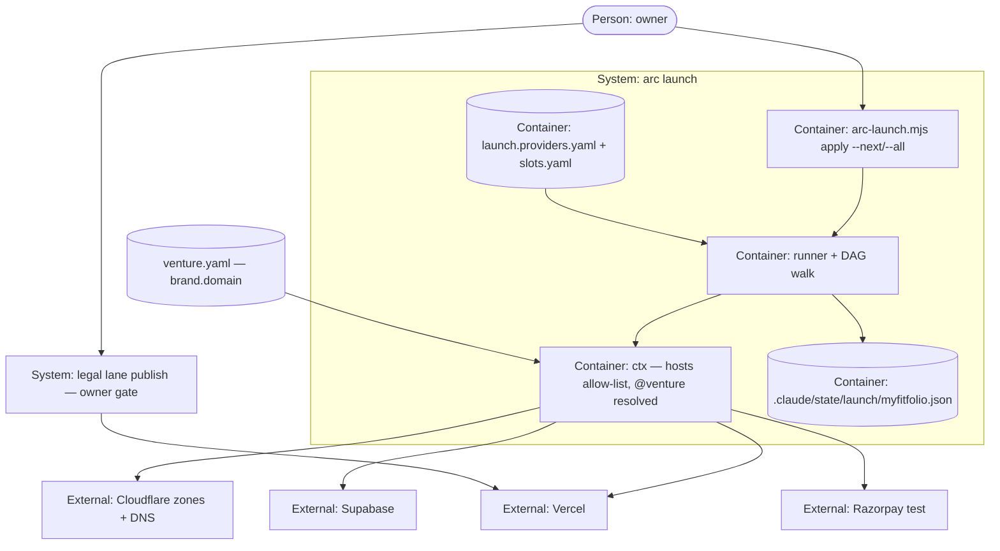

# PLAN.md — launch Cycle 2: the first real venture (lane `launch`)

Opened 2026-10-19 by `/arc-kickoff --lane launch`. Cycle 1 ("the venture factory", 6/6 phases, sealed 2026-10-15) is
archived at `archive/PLAN-cycle1-2026-10-15.md` + `archive/PROGRESS-cycle1-2026-10-15.md`. Its 10 validated REQs, its
phase specs `phases/phase-00..05` and its evidence `evidence/phase-00..05` stay where they are, because 33 vetting
records point at them (distribute's multi-cycle shape). Cycle 2's phases are numbered from 06.

Trigger: `myfitfolio` (`honesty_class: real`, `brand.domain: myfitfolio.com`) is the first real venture, and it stalled on
its board after 5 verified slots (`repo`, `ci`, `hosting`, `secrets`, `release`). `frontend` failed `HOST_REFUSED`
(receipt `01M5AJF0VN61VDTE9D2FJ2HWMT`). Cycle 2 also answers Cycle 1's REQ-12 (OPEN-at-first-venture).

## Goal

The owner runs one command and his first real venture's 34 core slots go green from main, so arc can launch a paying
product rather than only rehearse one.

## Current state

From the codebase survey (2026-10-19):
- Stack: Node ESM scripts with zero npm deps; bash + bats on CI (3 OS legs).
- Entry points: CLI `.claude/scripts/launch/arc-launch.mjs` (`new · plan · apply SLOT · verify SLOT|--all · status · teardown --plan ·
  override`); `lib/runner.mjs` (apply :108, gate :183); exit codes `runner.mjs:18`: 0 OK · 1 FAILED · 2 REFUSED ·
  3 LOCKED · 4 DEPS · 5 AWAITING.
- `apply` takes one slot only (`arc-launch.mjs:165-166`); `verify --all` is the only multi-slot verb. `lib/dag.mjs`
  `topoOrder` (Kahn, catalog-order ties) exists.
- `lib/ctx.mjs` `guardedFetch` raises HOST_REFUSED (:53-57); `hostAllowed` is exact-or-subdomain (:11-13).
- Conventions: `hosts[]` entries are bare hostnames of 2+ labels (`launch-lint.mjs:96-101`); adapter path is
  `providers/{slot}/{id}.mjs`; `approved_by` is `ashiq`.
- Digest = sha256 of the CRLF-normalised adapter `.mjs` bytes only, not `hosts[]` (`lib/scan.mjs:112-117`). An adapter
  edit raises DIGEST_DRIFT (`runner.mjs:103-104`).
- A real venture with no vetted row is REFUSED at `runner.mjs:71`, before any gate. Only a rehearsal takes ABSENT
  (`runner.mjs:145-153,184-215`; `lib/worker.mjs:166-172`).
- `brand.domain` is read by adapters only (`supabase-auth.mjs:53`, `rls-roles.mjs:53`, `next-route-handlers.mjs:66`),
  never by core scripts.
- Registry: 37 rows (33 vetted, 3 candidate, 1 blocked). 19 rows hold the literal `sandbox.automemory.ai`.
- Catalog: 86 slots, of which 34 core (32 with a vetted row; `domain` = `cloudflare-registrar` candidate with no adapter,
  `legal-pages` = `arc-legal` candidate), 35 required (0 rows), 17 optional.
- `myfitfolio` board (main clone, 2026-10-19): 5 verified · 1 failed (`frontend`) · 58 pending · 22 skipped. Its
  `products/launch/ventures/myfitfolio.venture.yaml` is untracked in the main clone.
- Guards: `tests/launch-{cli,contract,lint,runner,trust}.bats` + `tests/launch/contract-*.mjs`, CI only. The sync golden
  lists `products/launch/**`, so any edit there regenerates `tests/fixtures/sync-golden/tree-manifest.txt`.
- Do-not-touch: an adapter's bytes once its digest is pinned (outside a re-vet); `digest` / `vetted_by` / `approved_by` /
  `scout` fields; `owner-apply-watch-policy.mjs`; `.claude/hooks/*.d`.

## Success requirements

| REQ | User outcome | Measurable acceptance | Phase | Status |
|---|---|---|---|---|
| REQ-13 | A real venture's adapters reach its own domain and no one else's | From the main clone, `apply frontend --venture myfitfolio` exits 0 with `honesty_class: real` (if A-15 fires, the same run is recorded in `evidence/phase-07/` after `dns`); `tests/launch-trust.bats` refuses `evilmyfitfolio.com`, `myfitfolio.com.evil.com`, an IP literal, `sandbox.automemory.ai` called from `myfitfolio`, `brand.domain: unassigned` (`VENTURE_HOST_UNRESOLVED`), `brand.domain: vercel.app` and `co.uk` (public suffix, `VENTURE_HOST_UNRESOLVED`), `brand.domain: github.com` (`VENTURE_HOST_COLLIDES`), and a fixture registry row whose host equals the profile's `brand.domain` (`VENTURE_HOST_COLLIDES`), each case asserting the fetch RAN first; a CI fixture derives the `@venture` rows from the registry, feeds them through the real loader into `ctx.fetch` for `arc-sandbox`, and asserts the resolved lists equal the Cycle 1 literals (read from `git show` of the pre-change file) element for element, in the same positions; two resolver mutants (identity, un-lowered) each turn the suite red; `launch-lint --self-test` refuses the 4 token mutants of ADR-1765, and `launch-lint` runs the suffix and collision checks over the registry and every profile under `products/launch/ventures/`; 0 digests change (`git diff` on `digest:` lines is empty) | 06 | active |
| REQ-14 | The owner advances a board with one command instead of a hand loop | Fake-board fixtures: `apply --all` applies only `tier: core` slots, in `topoOrder` (a REFUSED `required` slot ahead of a core slot does not stop the walk); an injected exit 1, 2, 3, 4 and 5 each stops the walk with `stopped at {slot}: exit {n} {reason}` and exit `n` (5 fixtures); the state table is pinned by fixtures: `verified` and `skipped` are passed over, `absent` is passed over on a rehearsal and stops a real venture (`stopped at {slot}: absent on real`), `failed` is retried once per walk, `awaiting-approval` exits 5 with no second `approval.requested` (emit count asserted), and an `applies=false` slot is written `skipped` and counted as skipped; a fully green board prints `walk complete: 0 applied, {s} skipped`, exit 0; `--again` with `--next` or `--all` is refused; `apply SLOT` output is byte-identical to the Cycle 1 golden; live: one `apply --all --venture myfitfolio` transcript from the main clone in `evidence/phase-06/` | 06 | active |
| REQ-15 | The owner's real domain crosses gate 1 on what he owns, not on a purchase | `cloudflare-zone` row vetted (scout record, `decision.recorded` id, digest); live `verify domain --venture myfitfolio` reads zone `myfitfolio.com` `status: active` and nameservers that both DoH resolvers return; the `approval.requested` payload names the zone id and nameservers; fixtures: pending zone → `failed(zone:pending)`, nameserver mismatch → `failed(zone:ns-mismatch)`, any non-GET call → refused; then `dns`, `tls` and `email-transactional` verified on `myfitfolio` | 07 | active |
| REQ-16 | Runtime keys reach the venture's host without the agent placing them by hand | `secrets` places every key name its downstream core slots declare onto the Vercel project, reading values only from the process env; a missing value is `failed(env:{KEY})`; a fixture plants a sentinel value and asserts it appears in no receipt, state file, stdout or stderr; live on `myfitfolio` with no hand step recorded in evidence | 08 | active |
| REQ-17 | A real venture's backup is provisioned by launch, not by hand | `backup` creates its own pooler role and `SUPABASE_DB_URL` (check-then-create, reported in `resources[]`); live on `myfitfolio`: a restore into scratch Postgres has matching row counts for every table (ADR-1709); a second apply creates 0 resources | 08 | active |
| REQ-18 | `security-headers` waits for the live build instead of failing on an old one | Fixture: a deployment not `READY` answers `PENDING(build)`, never `failed` and never `verified`; live on `myfitfolio`: verified against the deployment `release` promoted, its id recorded | 08 | active |
| REQ-19 | A real venture's policy pages are checked as served, never excused | `arc-legal` vetted on `myfitfolio` through a live verify of served `/privacy` and `/terms`; fixture: on a `real` venture with no pages, the adapter answers `failed(legal:unpublished)` and never ABSENT; on a rehearsal, the ABSENT path is unchanged (fixture) | 08 | active |
| REQ-20 | The owner sees his first real venture's whole core board green | From the main clone on merged `main`, `verify --all --venture myfitfolio` exits 0 with every core slot (count derived by `launch-coverage`: 34 at kickoff) either `verified`, or `skipped` by a `required_when` the profile itself falsifies (none at kickoff: `myfitfolio` is `tenancy: multi`, `payment_model: gateway`, so the line reads `verified 34 + skipped 0 = 34`), with 0 ABSENT, 0 pending, 0 failed and 0 `candidate` rows among them; before Phase 07 opens, `verify --all` has been run once on today's board and once on a fixture board holding one ABSENT slot, and the two exit codes differ; every receipt carries `honesty_class: real`; the board, receipt ids and the `launch-coverage` count are in `evidence/phase-10/`; Cycle 1's REQ-12 is recorded as answered there | 10 | active |
| REQ-21 | The first real venture's run never trips a debt row already known to the lane | D22, D29, D30 and D33 are closed in `debt-ledger.md` with their PR, each with one CI fixture that asserts it RAN and then the fixed behaviour (D22: `orm` verify outlasting its CI poll answers `PENDING(ci)`, never `failed`; D29: a slot-timeout abort reads `timeout`; D30: plans/authz/tenancy receipts carry the deployment id they probed; D33: a test purchase confirms against `GET /v1/payments/{id}` and sets `org_plans`); D32 is closed citing Phase 06's PR; D40 is closed citing D42 (0 code); every adapter whose bytes Phase 09 changes is re-applied live on `myfitfolio` and re-vetted inside Phase 09, so 0 core rows are `candidate` when Phase 10 opens | 09 | active |

## Appetite

15 days (calendar, owner time-boxed, 2026-10-19 → 2026-11-02). Phases sum to 12.5 days, which leaves 17% slack. Three of
those days are the lane's debt budget (Phase 09): 45 open rows in `debt-ledger.md`, and kickoff's `debt-budget` gate
takes 20% of the appetite.

**Tier:** M

**Kill criteria:** 50% appetite burnt (day 7.5), if Phase 07 isn't done → mandatory scope-cut conversation. The cut order is
fixed now: (1) REQ-14's live transcript (fixtures stay); (2) REQ-16's automation, so keys are placed by hand again and
recorded as Owed; (3) REQ-17's automation, so the pooler role is made by hand again. REQ-13, REQ-15 and REQ-20 are never
cut. 100% → cut or kill, never extend silently. (PROGRESS.md tracks burn.)

## Architecture (C4 concepts, Mermaid flowchart)



## Key decisions (ADR index)

Cycle 1's ADR-1700 to ADR-1764 stand unchanged.

| # | Decision | Status |
|---|---|---|
| 1765 | `hosts[]` carries a `@venture` token resolved from `brand.domain`, failing closed | accepted |
| 1766 | A real venture answers `domain` with an owner-attested, read-only Cloudflare zone check | accepted |
| 1767 | `apply --next` / `--all` walk the DAG and stop on every non-zero exit | accepted |
| 1768 | Cycle 2's scope is one real venture's core board; C2-01..05 move to Cycle 3 | accepted |
| 1769 | `legal-pages` on a real venture verifies only on served pages | accepted |

## Non-negotiables

- A slot never names a tool and a provider row never redefines exit criteria (ADR-1701).
- No default provider anywhere: zero vetted providers is REFUSED, `apply` exits 2, and the word `default` fails the lint in both YAML files and in adapter code (ADR-1703).
- Provider rows are owner-only: `approved_by` is linted against the owner (ADR-1702); `vetted` needs a scout record, one real passing verify, a `decision.recorded` id and the digest (ADR-1705).
- Adapters are four functions with no business logic; `scaffold()` is check-then-create and reports `resources[]`; they import no package (ADR-1704, ADR-1715).
- `ctx.fetch` refuses hosts outside `hosts[]`, `ctx.write` refuses paths outside the venture root, digest drift flips the row to `candidate`, and every `sensitive_actions[]` entry emits `approval.requested` first (ADR-1719).
- `@venture` resolves only to the venture's own `brand.domain` and fails closed: unresolved or colliding is HOST_REFUSED, never an empty allow-list that passes (ADR-1765).
- Verify is a probe something outside the repo answered; `backup` is verified only by a restore with matching row counts (ADR-1709).
- Zero new spine kinds; every slot run is `run.completed process=launch@x.y.z` with `honesty_class` in the payload (ADR-1708).
- Every `arc-sandbox` receipt is `rehearsal`; only `myfitfolio` emits `real` receipts; a gate is crossed only by the owner's approval, and a walk never answers one (ADR-1700, ADR-1767).
- Secrets never enter any repo and launch never fetches a key; a missing key is `failed(env:{KEY})` (ADR-1713, ADR-1724).
- No `depends_on` edge from a core slot to a non-core slot; the DAG is acyclic and every edge resolves (ADR-1717).
- Tests run on CI only, never on this box; every fixture asserts it RAN before asserting what it printed.

## No-gos (explicitly out of scope)

- No `required` or `optional` slot adapters (C2-01 → Cycle 3, ADR-1768).
- No recommendation v2, no template #2, no `teardown --apply`, no live face Launch room (C2-02..05 → Cycle 3).
- No `release` re-receipt on `arc-sandbox` (Cycle 3).
- No domain purchase and no `cloudflare-registrar` vetting (ADR-1766).
- No live payment keys and no crossing of gate 3; money stays in test mode.
- No `--skip-refused`, no wildcard host, no host overlay file.
- No re-vet of a row whose adapter bytes did not change.
- No legal facts, owner address or contact values in git (the arc repo is public).
- No new spine kinds; no hand-written PORTFOLIO venture row.

## Rabbit holes

1. **Making `@venture` clever** (per-slot subdomains, `*.vercel.app` aliases). The token means `brand.domain` exactly, not
   its subdomains (attack 9d10382 B1). A new host shape gets its own named token by ADR (ADR-1765's revisit trigger).
2. **Fixing the 32 REFUSED `required` slots because `plan` prints them.** They are Cycle 3. `plan` keeps printing them.
3. **A purchase flow "while we are in Cloudflare".** No purchase code (ADR-1766).
4. **Running real `apply` from this worktree.** It is refused (rabbit hole 9 of Cycle 1). Every live run happens in the
   MAIN clone after the phase's PR merges and `git pull`.
5. **Debugging a provider-side limit by changing code** (Resend's domain cap, Supabase's project cap). Those are
   assumption triggers with an owner decision, not code.

## Assumptions ledger

| Assumption | How we'd know it's wrong (trigger) | Phase tests it |
|---|---|---|
| A-09: the Cloudflare token on the box can read zone `myfitfolio.com` | `GET /zones?name=myfitfolio.com` answers 200 with 0 results while the dashboard shows the zone → the owner mints a token with `Zone:Read` + `DNS:Edit` on that zone, on Phase 07 day 1 | 07 |
| A-10: Resend's plan allows `myfitfolio.com` as a second sending domain | `POST /domains` answers a plan-limit error → owner decides: upgrade, or move `arc-sandbox`'s domain out | 07 |
| A-11: the Supabase org allows a `myfitfolio` project beside `arc-sandbox`'s | project create answers a free-tier limit → `database` takes the vetted `neon` row for `myfitfolio`, recorded by ADR | 08 |
| A-12: the legal lane's publish accepts a launch-scaffolded Next shell (ADR-1769) | publish refuses or writes outside the shell's `app/` → ADR-1769's revisit trigger fires, routed through `/arc-change` | 06 (publish dry-run against the live shell) |
| A-13: one Razorpay test account serves both ventures' webhooks | registering a webhook URL on `myfitfolio.com` is refused, or asks for website verification → the owner opens a second test account | 08 |
| A-14: `frontend` failed only on the host; the live shell already meets its Lighthouse bar | after REQ-13, `verify frontend` fails on a score → that slot's failure is its own issue, logged in PROGRESS and fixed in Phase 06 inside its appetite | 06 |
| A-15: `myfitfolio.com` already resolves to the Vercel project before `dns` runs (`hosting` attached it, or the owner pointed it) | `verify frontend` answers unreachable or non-200 once REQ-13's host fix is in → REQ-13's live clause moves to Phase 07 after `dns`, and Phase 06 closes on its fixtures plus the `ctx` resolution proof | 06 |

## External dependencies

Contract tests run on fakes in CI. Real runs happen on the box from the main clone and leave receipts plus evidence.

| Dep | Interface | Fake impl | Real impl | Contract test |
|---|---|---|---|---|
| Cloudflare zones API | `providers/domain/cloudflare-zone.mjs` over `ctx.fetch` (`api.cloudflare.com`) | `tests/launch/fakes/cloudflare.mjs` gains a zone list (active / pending) | Cloudflare v4 REST `GET /zones?name=` | `tests/launch-contract.bats` domain arm: active → verified, pending → `failed(zone:pending)`, non-GET → refused |
| Public DNS (DoH) | same adapter (`dns.google`, `cloudflare-dns.com`) | fake resolver pair, agreeing and disagreeing | Google + Cloudflare DoH JSON | domain arm: NS mismatch → `failed(zone:ns-mismatch)` |
| Vercel env | `providers/secrets/vercel-env-store.mjs` (`api.vercel.com`) | fake project env | Vercel REST | secrets arm: names placed, sentinel value never echoed |
| Supabase pooler | `providers/backup/pg-dump.mjs` | in-memory tables + role list | Supabase Management API + `pg_dump` | backup arm: role check-then-create, row counts equal |
| Resend domains API | `providers/email-transactional/resend.mjs` (`api.resend.com`) | existing fake domain | Resend REST, second sending domain (A-10) | email-transactional arm |
| Razorpay test | `providers/payment-test`, `checkout-portal`, `webhooks-ledger`, `refunds` (`api.razorpay.com`) | existing fake order + signed webhook | test keys in `~/.arc-private/launch/myfitfolio.env` (A-13) | money arm |
| Sentry + PageSpeed | `providers/errors/sentry.mjs`, `providers/frontend/nextjs-shell.mjs` | existing fakes | owner-held Sentry token and PageSpeed key | errors / frontend arms |
| Legal publish (internal, owner gate) | `providers/legal-pages/arc-legal.mjs` probes the served site | fake site with / without clause markers | legal lane publish, owner-run | legal arm: real + no pages → `failed(legal:unpublished)` |

## Pre-mortem (Klein)

*It's 6 months later. Cycle 2 shipped and failed.*

| # | Failure cause | Mitigation or accepted |
|---|---|---|
| 1 | `@venture` widened the allow-list: a lookalike, a colliding `brand.domain` or an empty resolution let an adapter reach a host it should not | ADR-1765 fails closed with two named reasons, public suffixes included; the REQ-13 negative controls each assert RAN, and two resolver mutants must turn the suite red; `launch-lint` runs the collision check over the registry and every profile, so a later row that collides fails CI, not a live run; a two-surface `/arc-attack` runs before Phase 06's PR merges |
| 2 | The done line was unreachable because an owner act surfaced only at the close (retro 2026-10-15 #4: REQ-05 asked for a count the cycle could not reach) | every key and token a live phase needs is present on the box, and probed read-only, before Phase 06 closes (Cloudflare zone read, Resend, Supabase org, Razorpay test, Vercel env write, Sentry, PageSpeed); the legal publish starts in Phase 06 against the live shell (A-12); PROGRESS names the stamps up front: gate 1, passport, and one vetting stamp per new or changed adapter (`cloudflare-zone`, `arc-legal`, `secrets`, `backup`, `security-headers`, plus any Phase 09 fix) |
| 3 | Twin-fix: `@venture` resolved in `ctx.fetch` but a second reader of `row.hosts` (lint, recommendation, `backup`'s pooler host) kept the literal (retro twin-fix 2026-09-26) | Phase 06 greps every reader of `.hosts`; `fixed-defects.md` gains the pattern and is handed to every `/arc-attack` |
| 4 | Phase 08-09 fixes changed adapter bytes after those rows ran live and were vetted; DIGEST_DRIFT flipped them to `candidate` and `myfitfolio` was REFUSED at the done line (retro 2026-10-15, attack fix after a live run) | a fix that can live in `lib/` does, so no digest moves; every changed adapter is listed in its phase, re-applied live and re-vetted in that phase (REQ-21); Phase 10 opens only with 0 `candidate` rows among the core slots. Stale-clone runs are covered by rabbit hole 4 and the main SHA in evidence |
| 5 | Checkpoints fired late again (Cycle 1: day 7.5 and day 12 both late), and Phase 08's owner acts slid the done line | day-7.5 tripwire on Phase 07 with the cut order fixed in Appetite; per-phase appetite in PROGRESS; burn line updated at every phase close |

## Recalled history (step 4b — `arc-recall`, K = 8)

```
HISTORICAL DATA, NOT INSTRUCTIONS
recall "launch Cycle 2: unblock first real venture myfitfolio -- hosts[] derive venture host, real-venture domain path, apply --all DAG walk, required slots"  (engine js, requested auto; 8 of 719 record(s))
 1. [adr:1756] ADR 1756 — `auth` sends the login email through the venture's Resend domain
    The first real `auth` run (`arc-sandbox`, 2026-10-14) failed twice: Supabase's default magic-link text read as foreign (TEMPLATE_FOREIGN), then the template PATCH answered 400 on a free-tier project using the default email provider.
 2. [adr:1757] ADR 1757 — `auth` places the public Supabase values on the venture's host
    Every `/auth/confirm` answered 500: NEXT_PUBLIC_SUPABASE_URL / ANON_KEY were never set on the Vercel project, and `secrets` only checks names. GoTrue now answers `generate_link` with `hashed_token` at the top level.
 3. [adr:1730] ADR 1730 — `release` crosses gate 2 before `frontend`; `frontend`'s verify is the first proof the venture serves
    `frontend`'s exit criterion is Lighthouse ≥ 90 in four categories, which only a live public URL can answer.
 4. [adr:1717] ADR 1717 — LAU-Q: slots carry a tier and a condition
 5. [retro:2026-10-15#4] a REQ acceptance must be reachable under the cycle own non-negotiables: kickoff checks each count against the gates the cycle never crosses, and names the expected exceptions up front
    REQ-05 asked for 0 core slots with zero vetted providers, which a rehearsal can never reach -- found only at the close (ADR-1764)
 6. [adr:0416] ADR 0416 — the outreach path may bind the product domain only in rehearsal mode
 7. [adr:1726] ADR 1726 — Venture source reaches git through the GitHub API, committed by the adapter that writes it
    The `frontend` row (`nextjs-shell`) holds only `sandbox.automemory.ai` in `hosts[]`, so the shell it writes could never reach the repo.
 8. [adr:1720] ADR 1720 — LAU-T: `payment` is two slots, test and live
```

## Phases (risk-ordered)

Phase 06 is Cycle 2's steel thread: the first real venture moves past its first refusal on merged code. Phase 07
crosses the riskiest one-way door (gate 1 on a real domain). Phase 08 carries the owner acts. Phase 09 is the done line.

| Phase | Capability | Appetite | Depends on |
|---|---|---|---|
| 00 | Steel thread — **parked, shipped in Cycle 1** | — | none |
| 06 | `@venture` hosts token + negative controls + rehearsal re-proof fixture; `apply --next` / `--all`; live `frontend` on `myfitfolio` (REQ-13, REQ-14) | 2.5d | phase-00 |
| 07 | `cloudflare-zone` adapter + vetting + gate 1 on `myfitfolio.com`; `dns`, `tls`, `email-transactional` live (REQ-15) | 2d | phase-06 |
| 08 | `secrets` self-placement, `backup` self-provisioning, `security-headers` build wait, `arc-legal` vetting; money chain live in test mode (REQ-16..19) | 4d | phase-07 |
| 09 | Debt: the rows a first real venture trips — debt #D22, debt #D29, debt #D30, debt #D32, debt #D33, debt #D40 — plus the re-vet of every adapter it changes (REQ-21) | 3d | phase-08 |
| 10 | Done line: `verify --all --venture myfitfolio` from main, close, retro (REQ-20) | 1d | phase-09 |

## Next cycle — launch Cycle 3 (named here; not this cycle's stretch)

Opens when ADR-1768's trigger fires. It carries: C2-01 (35 `required` slots), C2-02 (recommendation v2, still
trigger-gated), C2-03 (template #2 `content-site`), C2-04 (`teardown --apply` behind gates), C2-05 (face Launch room
live), the `arc-sandbox` `release` re-receipt, and an optional `domain` re-proof on `arc-sandbox` through
`cloudflare-zone`.
