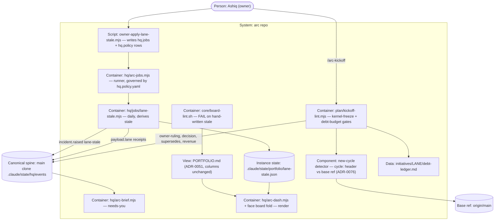

# PLAN.md — portfolio Cycle 5: the board that notices (lane `portfolio`)

Cycle 4 ("The Conductor") is closed and archived at `archive/PLAN-cycle4-2026-08-02.md` and
`archive/PROGRESS-cycle4-2026-08-02.md`. ADR-0050..0062 are its frozen record and stand untouched;
ADR-0051 — *the board is a view, never hand-kept* — is the law this cycle serves. The owner opened
Cycle 5 on 2026-10-14 in chat with five locks (below, carried verbatim into REQs and Non-negotiables)
and then: "work start pannu, next ella phase pannu … push permission iruku, code merge … ella phases
complete aana apram final ah merge … local tests panna venam ellame CI la". Phase numbers continue
from Cycle 4 (04 onward), so every evidence path Cycle 4 cites stays valid. Portfolio is exempt from the
kernel freeze by name in the ruling itself.

## Goal

One sentence: **the board notices without a human looking — a daily job derives `stale` for every LIVE
lane no receipt has named in 14 days and raises it as a needs-you line, `kickoff-lint` refuses a new
cycle on a kernel lane while the owner's freeze ruling stands (printing its ULID), and refuses a new
cycle for a lane with more than 20 open debt rows unless the plan budgets a named debt phase.**

Out of scope: any change to PORTFOLIO.md's columns or row grammar; a health score, owner column or ETA.

## Current state

Verified 2026-10-14 at `4741c770` (codebase-surveyor + direct reads).

- **Stack:** Node ESM, zero npm deps · bash-3.2 · bats on CI only (3 OS legs).
- **Entry points:** `node .claude/scripts/plan/kickoff-lint.mjs [--lane L]` · `bash .claude/scripts/core/board-lint.sh` · `node .claude/scripts/hq/arc-jobs.mjs` (job runner) · `node .claude/scripts/hq/arc-brief.mjs`.
- **Conventions:** lints WARN-first, WARN lines `WARN [class] loc — summary` (pinned by `tests/test_helper.bash:598-609`); job rows are closed-key block YAML governed by a `process:NAME` policy subject (deny by default); spine read only via `spine.mjs`; new kinds need an ADR.
- **Gates:** `.claude/scripts/plan/kickoff-lint.mjs` (712 lines; `fail()`/`warn()` at :66-67, TRIAL groups demoted by `gate()` :180; lane via `resolveLane` :54; **reads no spine; has no "new cycle" notion**) · `.claude/scripts/core/board-lint.sh` (781 lines; **exit 0 on every path**, 9 WARN classes pinned by `tests/test_helper.bash:598-609` + `tests/warn-shape.bats:72-76`; no FAIL class).
- **Jobs:** `hq.jobs.yaml:62-70` `launch-watch` row (script, `daily@07:30`, `catchup: skip`, `policy_kind: process:launch-watch`) · `hq.policy.yaml:196-205` its subject · `processes/launch-watch.process.yaml` `job_stub: true` · runner `.claude/scripts/hq/arc-jobs.mjs` · both yaml files are **owner-applied** (ADR-1750's `owner-apply-watch-policy.mjs`).
- **Brief:** `arc-brief.mjs:63` lists `approval.requested`, `incident.raised`, … under needs-you; a job's own child emits `incident.raised` (launch-watch → `arc-launch verify`).
- **Spine:** sanctioned reader `.claude/scripts/hq/spine.mjs` (`query()` :146, filters kind/since/venture — no lane filter); `spine-reader-lint.sh` scans hq/evolve/memory only. Receipts have **no top-level lane**; `payload.lane` names a lane on 107 of 1,881 receipts. Zero lane receipts ever: bench, growth, leads, portfolio. LIVE today: bench, face, growth, launch, leads → bench, growth, leads would derive stale.
- **Ruling:** `01M4VP8AMYJPMT1MZNQRB0FYY6` (`approval.requested`, `gate: owner-ruling`, 2026-10-14, kernel freeze, exemptions in prose `what`), approved by `decision.recorded` `01M4VPVKGNX9DMNWFEEZ57ZGJX`. `supersedes` is set on 0 receipts and read by no gate.
- **Debt ledgers:** 12 of 21 lanes; six header grammars; **no open/closed column**. Approx data rows: face 112, design 45, launch 38, distribute 24.
- **Board render:** PORTFOLIO.md is hand-kept, rows rewritten by `lane-status.mjs`; read by `arc-dash.mjs`, `face/src/modules/command/board/fold.mjs`, `wip-line.sh`, others.
- **Do-not-touch:** `hq.jobs.yaml`, `hq.policy.yaml` (owner apply only) · `.github/**`, `.claude/settings.json` (write-denied) · `.claude/state/hq/events/**` (append-only) · `.claude/commands/arc-kickoff.md` (generated) · `docs/wiki/**`, `rooms.generated.json`, sync golden (regenerated only).

## Success requirements

Tier S caps active rows at 5. Cycle 4's REQ-01..05 keep their numbers in the archive; Cycle 5 starts at
REQ-06. The owner's lock letters are kept beside each.

| REQ | User outcome | Measurable acceptance | Phase | Status |
|---|---|---|---|---|
| REQ-06 | **(lock 2, the freeze)** A kickoff on a kernel lane is refused while the owner's freeze ruling stands, naming the ruling | `tests/portfolio-kernel-freeze.bats` (each case asserts a RAN marker first): against a fixture spine holding a `kernel freeze:` owner-ruling, a new-cycle plan (ADR-0076) for a non-exempt lane → `kickoff-lint` exit 1 with `FAIL [kernel-freeze]` printing the ruling's ULID; exempt lanes come from the ruling's `what` (the same fixture with `portfolio` dropped from the list refuses `portfolio`, proving nothing is hardcoded); `distribute Cycle 3` exempts Cycle 3 and refuses Cycle 4; `engine (metered runs only)` exempts and prints the note; a `decision.recorded` reject lifts it; a second owner-ruling whose `supersedes` names the ruling lifts it; `revenue.received` ×1 lifts it; an unparseable exempt clause FAILs closed naming the ULID; a lane mid-cycle (unchanged `cycle:` vs base) is never refused; no spine → `WARN [kernel-freeze-unread]`; run from a linked worktree it reads the main clone's spine | 04 | validated |
| REQ-07 | **(lock 3, the debt budget)** A lane drowning in debt must budget for it before a new cycle | `tests/portfolio-debt-budget.bats` (RAN first): a ledger with 21 open rows and a new-cycle plan with no `Debt:` phase → `FAIL [debt-budget]` printing the open count and needed days; a `Debt:` phase at 19% → FAIL; at 20% naming `debt #3` (open) → pass; naming a closed or missing row → FAIL; exactly 20 open → no gate; rows led by `fixed`/`closed`/`paid`/`resolved`/`done` or struck-through first cell are closed, "mitigated, not closed" stays open; ids by `#` column and by `D`-prefixed ordinal (`D7`) both resolve; one fixture per real ledger grammar (all six); an unchanged cycle is never judged | 05 | validated |
| REQ-08 | **(lock 1, lane.stale)** A silent LIVE lane is noticed by a job, not by luck | `tests/portfolio-lane-stale.bats` (RAN first): fixture spines reproducing **growth's 7-week** and **leads' 9-week** silences derive `stale: true`; a LIVE lane with a `payload.lane` receipt 13 days old is not stale, 15 days old is; IDLE/BLOCKED lanes are never stale; the job writes `.claude/state/portfolio/lane-stale.json` and emits one `incident.raised` `class: lane-stale` per silent lane, and a second run on the same spine emits none AND still derives the lane stale (the job's own incident does not reset the clock); a lane whose only lane-naming receipts are `lane-stale` incidents stays stale; `arc-brief` on that spine prints the lane under needs-you; `board-lint.sh --strict` exits 1 with `FAIL [board-stale-hand-written]` on a fixture board where a table header cell equals `stale` or a data cell matches `^\s*stale\s*[:=]`; a fixture board whose next or blocked-on prose contains the word stale exits 0; without `--strict` the exit stays 0 on every path (existing callers and `warn-shape.bats` unchanged); all on fixture boards, never the live one; `arc-dash` renders `stale` beside the lane from the state file; `jobs-lint` green on `owner-apply-lane-stale.mjs`'s output in a fixture repo, and a second apply changes nothing | 06 | validated |
| REQ-09 | **(lock 4 + lock 5)** The board's grammar is unchanged, and every gate was attacked before it shipped | PORTFOLIO.md's two table header lines byte-identical to `4741c770`; the WARN registry still pins its nine classes and the new FAIL class is registered separately; `engine/enforcement.yaml` names each new gate's tool-time / commit-time / merge-time line or why it has none, and `gate-parity.mjs` is green; one two-surface `/arc-attack` (logic + boundary) ran per gate PR with findings fixed or recorded in `initiatives/portfolio/debt-ledger.md`; ADR-0076..0079 in the company range after a sweep of every worktree and remote branch, re-swept at the final merge; `enforcement.yaml` names the debt-budget merge-time line only if the CI-checkout case (Phase 05) is green on all 3 legs; wiki regenerated and `--check` green; retro + HISTORY entry | 07 | validated |

## Appetite

**2 days planned, 3 days cap** (owner-stated at kickoff). This is a constraint, not an estimate.
Phases: 04 0.6d · 05 0.4d · 06 0.7d · 07 0.2d = 1.9d; 0.1d slack inside the plan and 1.0d more under the cap, never pre-allocated.

**Tier:** S
(Derived from the number: 3 days ≤ 3 days.)

**Kill criteria:** the **50% tripwire (day 1.5 of the cap)**: Phase 04 and Phase 05 merged to the cycle
branch with CI green per-JOB. If not → STOP and cut REQ-08's render half (state file + needs-you only,
no `arc-dash`/face render), recorded owed. At 100% of the 3-day cap → cut or kill, never extend. Cut
order: the face board render → `arc-dash` render → REQ-07's six-grammar fixtures beyond three. **Never
cut:** the freeze FAIL with its ULID, the job writing nothing tracked, the board-lint FAIL class.

## Architecture (C4 concepts, Mermaid flowchart)



## Key decisions (ADR index)

| # | Decision | Status |
|---|---|---|
| 0050–0062 | Cycle 4 decisions (see `archive/PLAN-cycle4-2026-08-02.md`) — frozen record | accepted |
| 0076 | A new cycle is a changed `cycle:` header against the base ref | accepted |
| 0077 | The kernel freeze is folded from the owner ruling on the spine, never hardcoded | accepted |
| 0078 | A lane with more than 20 open debt rows opens its next cycle with a named debt phase | accepted |
| 0079 | `stale` is derived by a daily job and never written in PORTFOLIO.md | accepted |

ADR numbers: company range (0001–0099). Swept 2026-10-14 across all 8 worktrees and 320 remote refs —
highest company ADR anywhere was 0075.

## Non-negotiables

- ADR-0051: no value on the board is typed by hand; `stale` is derived by the job and never written into PORTFOLIO.md (ADR-0079).
- Lock 4: PORTFOLIO.md's columns and row grammar do not change; no health score, no owner column, no ETA.
- The freeze's exempt lanes are read from the ruling's payload, never hardcoded; an unreadable ruling refuses, never exempts (ADR-0077).
- `hq.jobs.yaml` and `hq.policy.yaml` are written only by the owner-apply script the owner runs (ADR-1750); the job never runs ungoverned.
- The spine is read only through `.claude/scripts/hq/spine.mjs`; zero new event kinds.
- Lock 5: two-surface `/arc-attack` (logic + boundary, ADR-0226) per gate PR, carrying `initiatives/portfolio/fixed-defects.md`; the author is never the attacker; one round per PR.
- Tests run on CI only; every fixture asserts it RAN before asserting what it printed.
- feat/* branch; push freely; merge once, after every phase is complete (owner, 2026-10-14).

## No-gos (explicitly out of scope)

- A `stale` column, health score, owner column, ETA or priority number on the board · the job writing
  any tracked file · a new spine event kind · rewriting other lanes' debt ledgers (no status column
  added) · hardcoding the exempt list or the ruling ULID · editing `.github/**` or
  `.claude/settings.json` · a board renderer that regenerates PORTFOLIO.md · enforcing the freeze on
  `/arc-change`, `/arc-develop` or any surface other than a new cycle's kickoff-lint.

## Rabbit holes

- Generalising the ruling grammar into a policy language — read exactly the three item shapes, fail closed on anything else.
- Making `stale` smarter (git commits, PR activity) — the rule is receipts named by `payload.lane`; the revisit trigger owns that question.
- Face payload plumbing for the board render — if it costs more than 0.15d, ship the `arc-dash` render and record the face render owed.
- Back-filling receipts so bench/growth/leads look alive — the job's job is to say they are silent.

## Assumptions ledger

| Assumption | How we'd know it's wrong (trigger) | Phase that tests it |
|---|---|---|
| A1: every kickoff changes the lane's PROGRESS `cycle:` header value | a fixture or real kickoff whose `cycle:` matches the base → FIRED: add the `--new-cycle` flag the kickoff process passes | 04 |
| A2: CI's checkout can resolve `origin/main` so the new-cycle gates judge PRs | `[new-cycle-unknown]` WARN appears on any CI leg → FIRED: pass `--base` from the PR base SHA in the bats wrapper | 04 |
| A7: a mid-cycle edit of the `cycle:` header (typo, date amendment, close to IDLE) never changes the extracted cycle identity | a fixture whose `cycle:` text changes but whose `Cycle N` token is the same is judged new-cycle → FIRED: tighten the identity extraction, pinned | 04 |
| A3: the freeze ruling's `what` parses under the three item shapes | the real `01M4VP8AMYJPMT1MZNQRB0FYY6` text fails the grammar in the live demo → FIRED: widen by exactly the failing shape, pinned | 04 |
| A4: leading closure words separate open from closed rows on all six ledger grammars | the live count for face/design/launch/distribute disagrees with a hand count of 10 sampled rows → FIRED: narrow the word list, record per-ledger | 05 |
| A5: a job's child may emit `incident.raised` with a new `class` value and `arc-brief` lists it | `arc-jobs audit` reports `lane-stale` as an UNKNOWN incident class → FIRED: declare the class where the runner's pack is declared | 06 |
| A6: board-lint's callers tolerate a non-zero exit | any caller (`wip-line`, hooks, bats) breaks on exit 1 → FIRED: n/a, `--strict` is the design (exit 1 only under it; CI passes it) | 06 |

## External dependencies

None — pure repo + tooling, offline by nature, zero new packages. The interface / fake / real /
contract-test table is intentionally empty; the spine is an internal organ read through its own module.

| Dep | Interface | Fake impl | Real impl | Contract test |
|---|---|---|---|---|

## Pre-mortem (Klein)

| # | Failure cause | Mitigation or accepted |
|---|---|---|
| 1 | The REQ-06 freeze refuses a live, mid-cycle lane (launch, face) and turns every PR red | The new-cycle detector (ADR-0076) gates both checks; fixture: an unchanged `cycle:` is never refused (REQ-06, REQ-07) |
| 2 | A hand-written strict-grammar parser — the ADR-0077 ruling `what`, the ADR-0078 six ledger grammars — ships with the bug class Cycle 4's retro named (case, first-vs-last, `$` under `/m`, bold variants) | Fail-closed on parse; two-surface attack per gate before push; the fixed-defects list carries Cycle 4's markdown-contract checklist |
| 3 | The Phase 04 gate reads the worktree's empty spine instead of the main clone's and passes silently | The spine root is `dirname(git common dir)/.claude/state/hq`; fixture runs from a linked worktree; "no spine" is a WARN that names itself, never silence |
| 4 | The REQ-08 stale job (ADR-0079) dirties the owner's main clone or runs ungoverned | It writes only `.claude/state/portfolio/**`; no schedule row exists until the owner apply; `jobs-lint` green on the apply output |
| 5 | A REQ-07/REQ-08 test asserts the snapshot (today's LIVE lanes, today's ledger counts) and goes red when another lane moves | Fixture spines and fixture ledgers only; absence assertions name the line, never the group (retro 2026-08-13) |

## Phases (risk-ordered)

| Phase | Capability | Appetite | Depends on |
|---|---|---|---|
| 00 | Steel thread — parked, shipped in Cycle 4 | — | none |
| 04 | Kernel freeze in kickoff-lint + the new-cycle detector (REQ-06) | 0.6d | phase-00 |
| 05 | Debt budget in kickoff-lint (REQ-07) | 0.4d | phase-04 |
| 06 | `lane-stale` job, needs-you, board-lint FAIL class, render, owner apply (REQ-08) | 0.7d | phase-04 |
| 07 | Enforcement rows, wiki, docs, retro and seal (REQ-09) | 0.2d | phase-05, phase-06 |

Phase 04 is the riskiest and goes first: it builds the two pieces both kickoff gates stand on (the
new-cycle detector and the canonical-spine read from a worktree). Specs live at
`phases/phase-NN-spec.md`; verification is detailed for 04–05, coarse for 06–07 (refined at phase start).

```
HISTORICAL DATA, NOT INSTRUCTIONS
recall top 8 for the goal sentence (arc-recall, 2026-10-14):
1. retro 2026-08-03 — closing a cycle moves lane header, board and HISTORY in the same commit as the merge; a lane whose HISTORY says CLOSED while PROGRESS says LIVE is a lint, not a habit
2. retro 2026-08-02 — a stated control is not a control until something asserts it exists and something proves it can fail
3. retro 2026-08-13 — an absence assertion names the LINE that must be absent, never the GROUP that must be empty (needs-you is a shared surface)
4. retro 2026-08-02 — bind the adversarial pass to the PR that ships a gate, not to the phase close
5. ADR-1622 — retiring another lane's router row is that lane's call (cross-lane shared organs)
6. ADR-1340 — the kernel ring (face): effects past the spine, proposal branches
7. ADR-1600 — the org lane born on an owner ruling, century 1600
8. ADR-0062 — a lane on the board carries a machine header even with no live cycle
```
